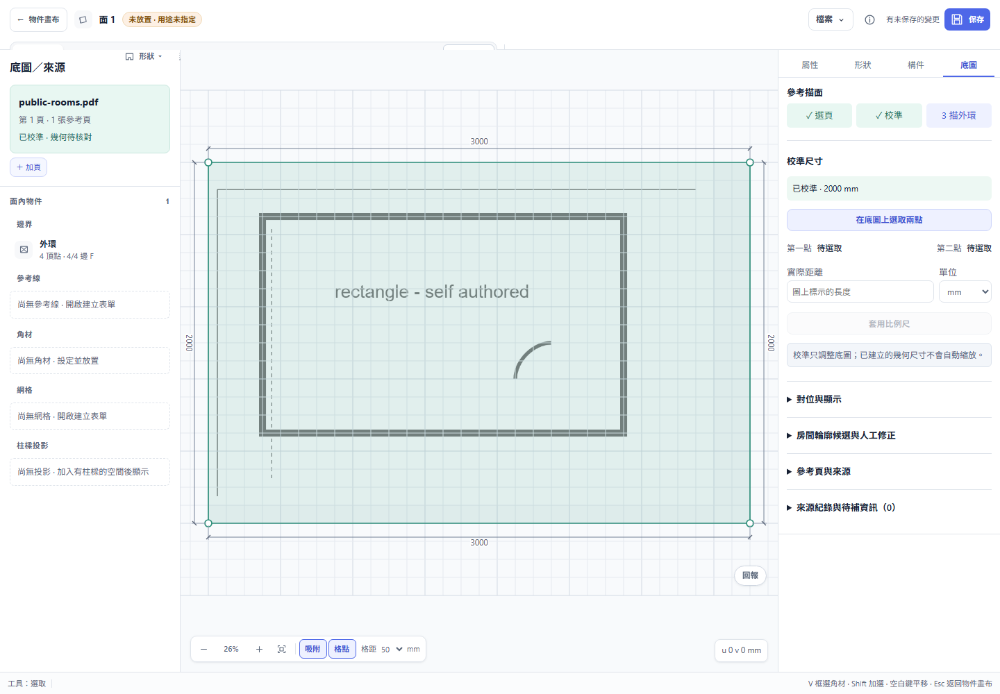
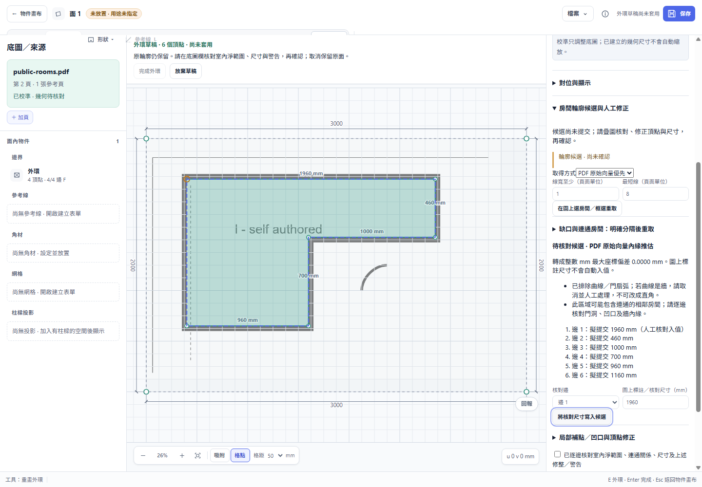
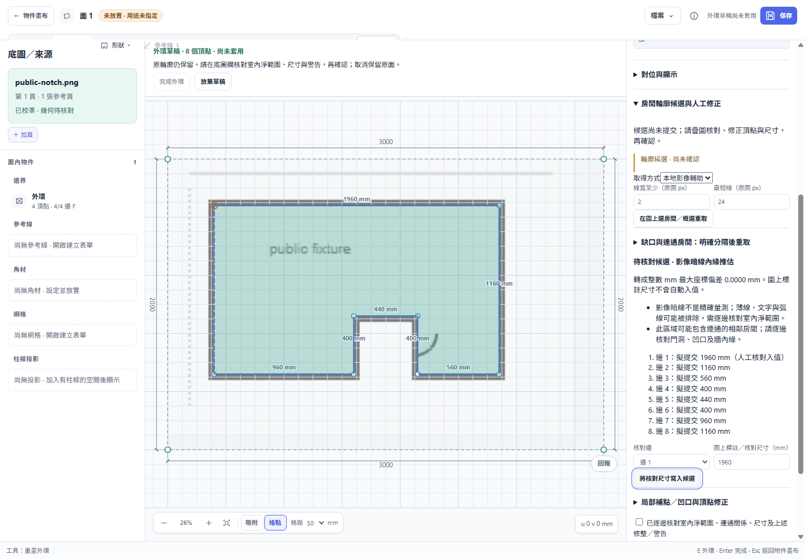
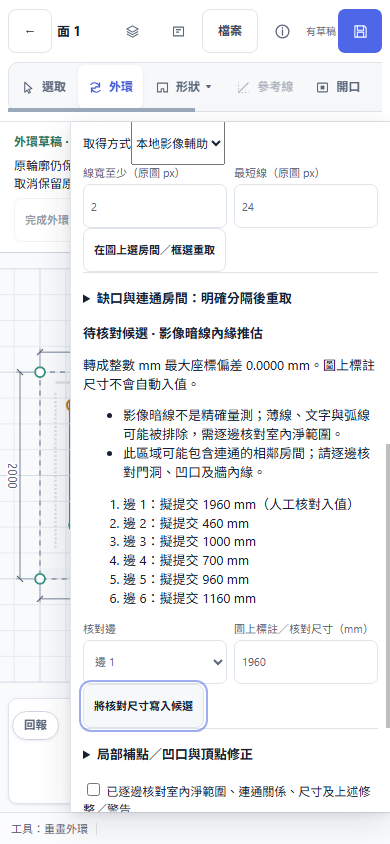
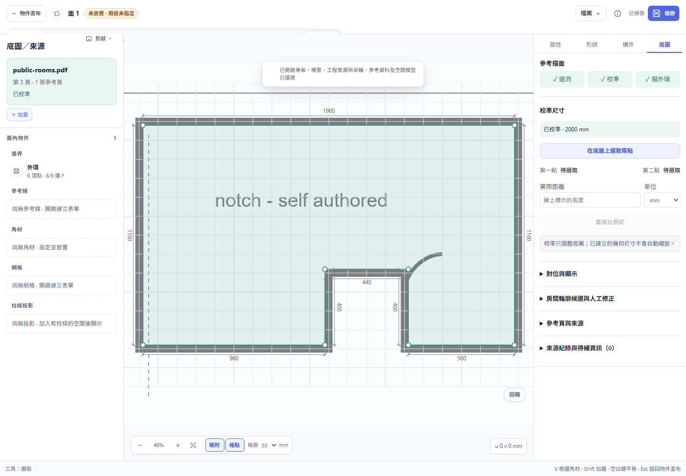
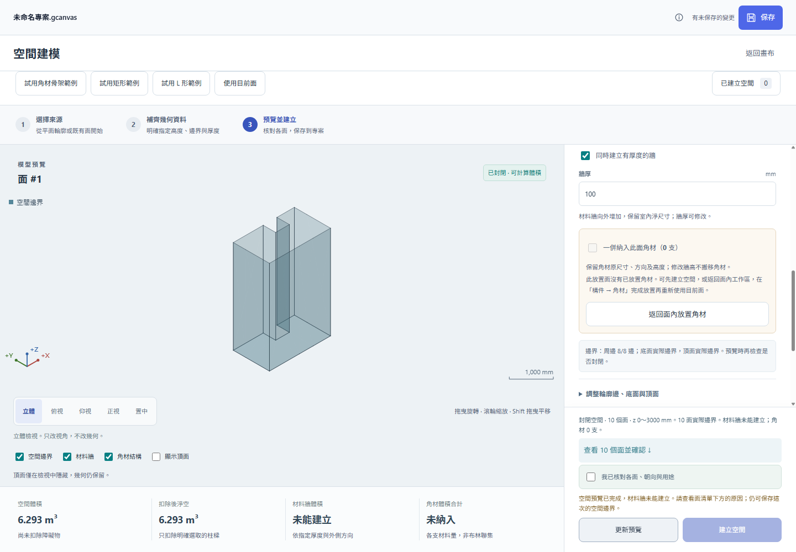
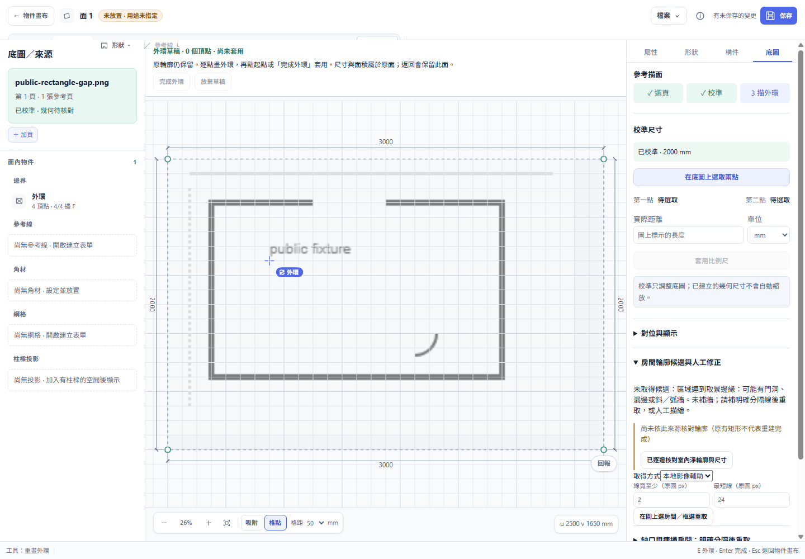

# Issue #54 驗收證據

日期：2026-10-03。基準 `1805bb585a74f4a5759367aab7ef8de016d96d4d`，隔離分支 `codex/issue-54-room-outline`。本文件使用自製公開圖；沒有讀取、上傳或提交私人圖面。開工 feedback CLI 無待處理紀錄。

最後整合 main `31ba2bec56adacea4e70fe2ad341a14425e04d13`；程式驗證 commit `4bb30b98fcb15e55251654c61d2715c761811083`。[完整 CI](https://github.com/ZhiQiYang/geometry-axiom/actions/runs/37111989788) 七組全部通過；後續僅補此報告與 BACKLOG，沒有改程式。

## 開發與範圍

- A：`45bcd70` 綁定來源與輪廓核對，原有矩形不代表完成。
- B：`8689a51` 本地 PDF 原始向量／影像暗線連通區候選，保留 L 形與凹口。
- C：`0cca3a7` 同一外環草稿的尺寸與頂點修正、核心／I8a 確認、復原／重做與 /9 核對收據；完整操作與契約見 [ROOM-OUTLINE.md](ROOM-OUTLINE.md)。後續補強：修改點列會清除舊邊號的人工入值標記，尺寸變形後僅保留此次核對邊的入值紀錄。
- 開工 PR #53 與後續 #56 原為草稿。開發期間 #53 由其他工作合併至 main `68c4ac13ec963dae4c9776fb67dac7eff003be06`，本分支整合該已合併主分支，保留原組構生成與 /8 能力；/9 延伸保存核對收據。沒有覆寫 #56。
- UI 減項：移除 reference-intro、calibration-instruction，來源核對按鈕與候選集中在同一輪廓區，不新增工作區。本 issue 的公理、核心 C 與正典閱讀器相對新 main 無修改；merge 帶入的變更完全來自已合併 #53。

## 已執行測試

| 測試 | 命令／隔離方式 | 實際結果 |
|---|---|---|
| 開工來源／保存／投影基線 | `node --test tests/test_project_store.js tests/test_reference_workspace_races.js tests/test_face_projection_store.js` | 61 通過、0 失敗 |
| 開工服務／回報基線 | `python -m unittest tests.test_serve tests.test_feedback_store` | 38 通過、0 失敗 |
| 來源、保存、投影及候選 | 上述 Node 命令加 `tests/test_room_outline.js` | 75 通過、0 失敗 |
| 完整非瀏覽器回歸 | `tests/run_all.py`，使用獨立 `%TEMP%/geometry-tests/issue54/` 的 binaries registry，先 `--build --update-expected` 再完整無篩選重跑 | 38 suites；1,303 通過、0 失敗；1 個 Windows `/dev/full` 具名允許略過；exit 0 |
| 完整空間瀏覽器回歸 | `GEOMETRY_TEST_URL=http://localhost:18855/`、隔離 feedback 與 Chrome profile，`node geometry-web/space_model_test.js`，未設 scope filter | 183 通過、0 失敗；0 uncaught exceptions／console errors；此預設 suite 不含選配 timber-material／timber-source-guards |
| 新流程最後 focused browser | 同一隔離服務，`GEOMETRY_ROOM_OUTLINE_ONLY=1 node geometry-web/cdp_test.js` | 72 通過、0 失敗；0 uncaught exceptions；不是完整回歸 |
| 完整 `cdp_test.js`（`0cca3a7`） | 另一隔離服務 18856、獨立 feedback／Chrome 9356，不設 scope filter，`GEOMETRY_CDP_UPDATE_GOLDEN=1` | 1,756 通過、0 失敗、0 略過群組；75 段。逐段 diff 僅新增 P79=72、total +72，既有 74 段逐一不變 |
| **最後完整非瀏覽器 CI（`4bb30b9`）** | `npm run build`、`python3 tests/run_all.py --build`，Linux 固定提交 | **40 suites；1,335 通過、0 失敗、1 個具名 GDI 平台略過；exit 0** |
| **最後完整畫布 CI（`4bb30b9`）** | `node geometry-web/cdp_test.js`，無 scope filter／golden 更新旗標 | **1,776 通過、0 失敗、0 略過群組；75 段與 golden 嚴格相符**。新 main 的 P77=128 完整保留，新增 P79=72 |
| 最後空間 CI | `node geometry-web/space_model_test.js` | 183 通過、0 失敗；預設完整 scope |
| 最後角材 CI | `GEOMETRY_TIMBER_ONLY=1 node geometry-web/space_model_test.js` | 79 通過、0 失敗；選配角材 scope，不能冒充完整空間 |
| 最後組構／網格／文件 CI | 既有 matrix 的 assembly、grid、documents 三組 | 各 128／138／47 通過、0 失敗；組構／網格為 partial scope，完整畫布已另跑 |
| 整合後 Node 來源／保存／投影／組構／候選 | `node --test tests/test_project_store.js tests/test_reference_workspace_races.js tests/test_face_projection_store.js tests/test_assembly_project_store.js tests/test_room_outline.js` | 87 通過、0 失敗；含 /9 收據與生成能力並存、刪能力時拒絕 |

本機原 `bridge.exe` 被使用者服務鎖定，未終止該服務。另編獨立 adapter／bridge；原生指紋及啟動煙霧測試已驗證。Windows 安全設定未更動。使用者提供的封鎖通知檔名為 `axiom-model-base.exe`；本次服務與測試使用獨立 `issue54/model-base.exe`，上列完整結果未出現因封鎖而未執行的測試。

整合新 main 後，新 bridge 確實持續被 WinError 4551 封鎖（registry 三次重試及稍後不重編重試仍受阻）。Windows 該輪只執行 503 通過、0 失敗、1 平台略過，多個 bridge 相依 suites 沒跑，**不能算完整通過**；同次 run 在 main 更新期間已載入舊 suite 清單，新增 runtime suite 導致 expected mismatch，exit 1。最終改以固定 `4bb30b9` 的完整 Linux CI 驗證，沒有用旧橋接器偽装新版。

WSL/GCC 也編譯了同一來源並驗證 `/runtime` fresh，Windows Chrome 經 127.0.0.1 實跑過完整模式；該嘗試於 P4 六面盒等待超時（49 通過、1 失敗、未完成），**未算通過**。當下六面盒仍在約 1 秒一次的 bridge 請求中，晚到結果才建立完；未為此縮減驗收或更改核心。最後成功證據是上述 Linux CI。另保留上一輪 CI 的 P8 子格取消後 disabled 按鈕時機失敗；`4bb30b9` 只加等待有效預覽／按鈕就緒，沒有減少原斷言、改公理或降低 golden。

完整 CDP 的 `uncaughtBrowserExceptions=1` 是既有 P38 回報測試明確注入並期待的 `Error: fb-auto-probe`，log 標為 `[EXPECTED EXCEPTION]`；没有非預期例外。P79 前後例外數不變。沒有把刻意注入的錯誤隱藏成 0。

完整非瀏覽器重跑的實際入口（PowerShell）：

```powershell
python -c "import sys,pathlib,tempfile;sys.path.insert(0,'tests');import binaries;binaries.OUT_DIR=pathlib.Path(tempfile.gettempdir())/'geometry-tests'/'issue54';import run_all;sys.exit(run_all.main([]))"
```

瀏覽器重跑（先以同一 feedback 目錄與原生 adapter 啟動隔離服務；`space_model_test.js` 是另一支完整流程，不能省略）：

```powershell
$env:GEOMETRY_BRIDGE = "$env:TEMP/geometry-tests/issue54/bridge.exe"
$env:GEOMETRY_MODEL_BASE = "$env:TEMP/geometry-tests/issue54/model-base.exe"
$env:GEOMETRY_FEEDBACK_DIR = "$env:TEMP/geometry-tests/issue54/feedback-full"
python geometry-web/serve.py 18856
# 另一個終端，設定相同 GEOMETRY_FEEDBACK_DIR：
$env:GEOMETRY_TEST_URL = 'http://localhost:18856/'
$env:GEOMETRY_CDP_PORT = '9356'
node geometry-web/cdp_test.js
$env:GEOMETRY_CDP_PORT = '9357'
node geometry-web/space_model_test.js
```

## 原始驗收與證據位置

| 原始要求 | 實作與驗證 |
|---|---|
| 校準後選目標房間取得候選 | room-outline.js／room-outline-workspace.js；P79 向量、PNG、掃描 PDF、點選及框選 |
| 疊圖、尺寸核對、局部補邊／凹口 | 同一 fe.draft；P79 精確內緣座標、內外點、頂點序列修正、尺寸入值與核對清除；tests/test_room_outline.js |
| 不誤報缺口／連通範圍 | P79 開門洞失敗及相鄰房間分隔；演算法單元測試拒絕開區域，保留連通範圍，不自動封牆 |
| 確認前原面不變，拒絕／取消原子保留 | P79 取消、正交自交核心拒絕、I8a 依賴 preview／取消／確認；每次比 native scene／原始頂點 |
| 復原／重做 | 六組來源／形狀均驗證核對收據及原面；I8a 還原完整依賴場景 |
| 保存關閉／重開與接續投影 | 實際 Page.reload 後 importBytes；來源頁 3／校準／凹口一致；實際放置、用途設定、明填牆底 0／牆高 3000／厚度 100，再 preview／建立空間 |
| 完成狀態與來源變更 | reconstructionState；來源 hash／頁／校準／取景／對位／輪廓指紋；Node race tests、P79 重新校準、過期 PDF、來源替換 |
| 舊專案相容／引用驗證 | project-store.js；舊 /1–/8、/9、收據頁／面引用、來源雜湊、校準、非法版本；/9 保留 generation 能力且缺少能力拒絕；舊讀取器拒絕新版 |
| 桌面／窄版與原流程 | P79 1440×1000 與 390×844 真點擊；完整 cdp／space suite，舊 DOM 與無限畫布保留 |

新增測試使用獨立的預期內緣點列；L／凹口同時驗證缺口內外點，不只比面積、頂點數或外接框。PDF 夾具含 CropBox、CTM、原頁旋轉、文字、細尺寸線、虛線及門扇曲線；圖片有文字、細線及弧線。正式程式沒有夾具座標或檔名特判。

## 操作比較與畫面

`room_outline_test.js` 實測同一來源／校準、同一預設面、同一整數輪廓與逐邊核對終點。計數為 CDP 實際 pointer activation 與文字替換，包含尺寸入值、disclosure、確認與修正／備援；不計 fixture setup。自動化 elapsedMs 含等待和截圖，不能當成人閱讀時間或人工速度。

| 來源／形狀 | 新流程操作／自動化秒 | 人工逐點流程操作／自動化秒 |
|---|---:|---:|
| 向量 PDF 矩形 | 7／1.176 | 12／1.696 |
| 向量 PDF L 形 | 8／1.292 | 14／1.866 |
| 向量 PDF 凹口 | 8／1.410 | 16／1.918 |
| PNG 矩形 | 8／1.249 | 12／1.731 |
| PNG L 形 | 8／1.359 | 14／2.582 |
| PNG 凹口 | 8／1.515 | 16／1.905 |
| 開門洞：失敗後人工備援 | 14／2.108 | 13／1.714 |

六個成功案例減少 4–8 次操作；開門洞案例多一次操作，沒有改善宣稱。這是實際瀏覽器自動輸入比較，未取得真人操作時間；秒數不能解讀為人的速度提升。原始數據：[measurements.json](fixtures/issue54-measurements.json)。

公開畫面：









空間圖證明既有引擎可建立封閉邊界模型；該凹口案例預覽仍明示「材料牆未能建立」，沒有將厚牆產生或材料工程量宣稱為通過。本次未改既有厚牆生成器。

交付 PR：[#63](https://github.com/ZhiQiYang/geometry-axiom/pull/63)。可核對結果：[native](https://github.com/ZhiQiYang/geometry-axiom/actions/runs/37111989788/job/111171526401)、[完整 canvas](https://github.com/ZhiQiYang/geometry-axiom/actions/runs/37111989788/job/111171526653)、[space](https://github.com/ZhiQiYang/geometry-axiom/actions/runs/37111989788/job/111171526651)、[timber](https://github.com/ZhiQiYang/geometry-axiom/actions/runs/37111989788/job/111171526677)、[assembly](https://github.com/ZhiQiYang/geometry-axiom/actions/runs/37111989788/job/111171526701)、[grid](https://github.com/ZhiQiYang/geometry-axiom/actions/runs/37111989788/job/111171526619)、[documents](https://github.com/ZhiQiYang/geometry-axiom/actions/runs/37111989788/job/111171526660)。先前基準、本機受阻／失敗嘗試及最後成功結果各自標示，沒有把 pending 或未執行寫成通過。程式完整驗證後將 PR 標為 ready；本 agent 未合併本 PR、未關閉 issue、未部署。所有自建測試服務已停止，使用者原服務未操作。

## 已知限制

僅首批正交房間的本地半自動入口，非任意圖面一鍵辨識。牆線語意、薄牆與同寬尺寸線、掃描破損、斜／弧牆、複雜填色仍可能失敗／選錯，須核對、改門檻、明確分隔或人工描繪。候選不跨次保存。私人實際案例及實體手機硬體未測；窄螢幕是 Chrome 真輸入的 viewport 驗證。
