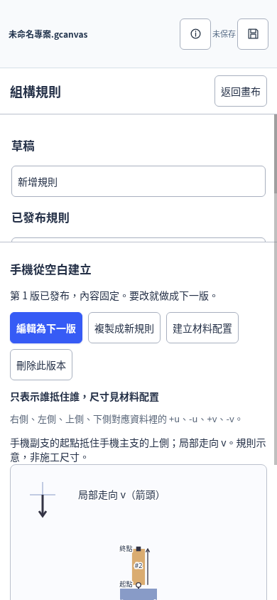
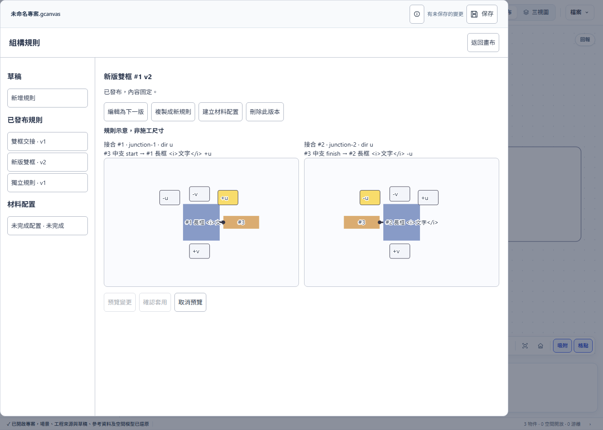
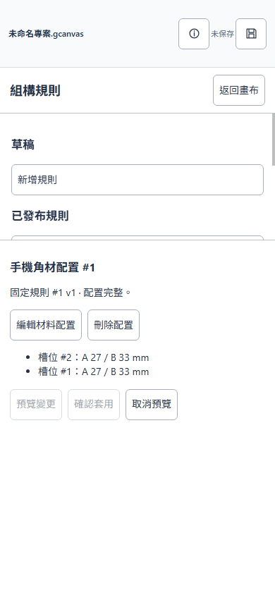

# 組構規則驗證紀錄

## 2026-10-02 配號修復與 A04／A13／A15／A18／A23 補驗

起點 `4e90a1c89256a96ed28a7a1096c9ca627912fc91`。本節記錄本輪修復版本；下方 PR #26 數量為歷史資料，不代表目前驗證結果。精確受測來源與原生二進位雜湊、可重跑命令見 [a15-provenance.json](a15-provenance.json)。C 原始碼未改；目前 source fingerprint 與所用編譯產物一致。

| 驗證 | 結果 | 證據 |
|---|---|---|
| Linux 非瀏覽器全套 | 1283 計數項目：1282 通過、0 失敗、1 既有具名 Windows GDI 平台略過；exit 0。自完整執行更新 census，未降低門檻。 | [日誌](a15-native.txt) |
| ASan＋UBSan 原生 assembly | 容量／型別、規則、ParameterRef 共 34 tests 通過，無 skip、無 sanitizer 診斷檔。 | [日誌](a15-sanitizers.txt) |
| Node assembly 三檔 | 41 tests 通過；含 native／draft 混合占用與 uint32 上界、版本預留、新增／編輯意圖封包 round-trip、來源變更拒絕。 | [日誌](a15-node.txt) |
| A15 舊碼反證 | 3 個新配號與碰撞 oracle 對起點舊 workspace 全部如預期斷言失敗；正常版本再跑 41 tests 全過。 | [預期失敗日誌](a15-node-baseline-rejected.txt) |
| 原生故障注入 | 衝突、遺失來源、取消預覽三種故障均由斷言偵測；注入前及還原後各 3 tests 通過，正常 binary hash 相同。 | [日誌](a15-native-mutations.txt) |
| 完整 CDP，不帶 filter | 1684 功能斷言通過、0 略過；原程序 **exit 1**，唯一 gate 差異是新增測試使 P77 從 84 增至 108。其餘 73 段全等。依完整觀察值只提高 P77 與總數，以既有 `buildGolden`／`compare` 驗 74 段吻合；不冒稱原程序 exit 0。精確 PR head 仍需 CI 無 filter 全跑。 | [原始日誌](a15-browser-full.txt)、[計數與來源紀錄](a15-provenance.json) |
| UI 故障注入與還原 | 交換鈕只改文字時立即由來源身分斷言偵測，預期 exit 1；正常 P77 再跑 108／0／0、exit 0、無瀏覽器例外。 | [預期失敗](a15-ui-mutation.txt)、[還原重跑](a15-browser-restored.txt) |
| 正典／見證 | 同步 99 個補丁與 `--check` 通過，閱讀器無 diff；完整 native run 內 25 個閱讀器 tests 通過；31 張見證一致。 | [命令與來源紀錄](a15-provenance.json) |

完整 CDP 唯一瀏覽器例外是 P38 刻意觸發的 `fb-auto-probe`，沒有非預期例外。先前兩次未完成執行不計為通過：第一次服務以 8 MiB stack 啟動並於 P8v4 終止；第二次已修為 16 MiB，但測試 URL 少了尾 `/` 而觸發 P24 嚴格比較，於 P35 主動停止。完成的最後執行使用 16 MiB、帶 `/` 的 URL 及隔離 feedback；[堆疊設定紀錄](a15-browser-stack-incomplete.txt)與[網址設定紀錄](a15-browser-url-incomplete.txt)保留原結果。沒有為這些設定問題修改產品或放寬測試。

A24 仍未在實體手機執行。#19／#24 保留 open；#25 生成器及 #43–#49 提案維持未實作。具體操作與人工驗收表見[驗收矩陣](../ASSEMBLY-RULES-VALIDATION.md)。

## PR #26 歷史驗證紀錄

2026-10-01。最終瀏覽器版本 `423bf663`，包括組構功能、空間回歸修正、非同步等待、名稱逸出及參數試算競爭修正。
完整 CDP 從這個版本重新啟動、不帶 ONLY/filter；下列局部流程補充驗證各自範圍。
功能提交 `8de7423`、空間修正 `d6a2e3b`、測試修正 `4b3eca8`；SSOT `82074011`。
來源與原生執行檔雜湊、編譯器及瀏覽器版本見 [provenance.json](provenance.json)。

| 驗證 | 結果 | 證據 |
|---|---|---|
| 完整瀏覽器 CDP | 1517 個斷言通過、0 失敗、0 略過群組 | [日誌](browser-full.txt) |
| 組構桌面／390px 流程 | 26 個斷言通過，0 瀏覽器例外 | [日誌](browser-assembly.txt) |
| 空間完整流程 | 183 個斷言通過，0 瀏覽器例外／console error | [日誌](browser-space.txt) |
| 角材及來源守門 | 79 個斷言通過，0 瀏覽器例外／console error | [日誌](browser-timber.txt) |
| 網格與子格 | 79 個斷言通過，0 瀏覽器例外 | [日誌](browser-grid.txt) |
| 畫布組合／建立入口 | 52 個斷言通過，0 瀏覽器例外 | [日誌](browser-composition.txt) |
| 共用保存／選取／參數局部回歸 | 分別 52／37／36 個斷言通過，0 瀏覽器例外 | [保存](browser-ux.txt)、[選取](browser-selection.txt)、[參數](browser-parameters.txt) |
| Linux 非瀏覽器全套 | 1203 個計數項目：1202 通過、0 失敗、1 GDI 平台略過；exit 3 | [日誌](nonbrowser.txt) |
| Windows GDI | 以目前來源重編，1 個 test 通過 | [日誌](windows-gdi.txt) |
| Windows 組構／共用基準 | 28 個 test 通過 | [日誌](windows-native.txt) |
| Windows 全套嘗試 | 已執行 184 項通過；部分執行檔受 SAC 阻擋／registry 標為缺少或 stale，其他 suite 未跑，exit 1 | [環境紀錄](windows-suite-environment.txt) |
| 正典閱讀器 | 重建 99 個補丁、五道 assert、獨立 SSOT；check 及 25 個 test 通過 | [重建](reader-sync.txt)、[check](reader-check.txt)、[tests](reader-tests.txt) |
| 見證圖／範例 | 31 張見證一致；正式核心產生的範例可重建 | [見證](witness.txt)、[範例](example.txt) |
| 原生故障注入 | 正常基準通過；3 種故障都由斷言偵測 | [日誌](mutations.txt) |
| UI 故障注入 | 交換只改文字時，核心身分斷言如預期失敗；正常流程再跑通過 | [預期失敗](ui-mutation-expected-failure.txt) |

完整 CDP 的 1 次瀏覽器例外是 P38 主動觸發的回報擷取探針；組構、空間與角材流程沒有未處理例外。
各列使用不同計數單位且可能覆蓋相同流程，不相加宣稱端到端案例數。
Linux 的單一 skip 保留非零退出碼，Windows 的未執行 suite 不列為通過；Windows GDI 另行實測。
非瀏覽器全套、故障注入及 Windows 原生測試使用相同最終 C 來源；後續變動為前端／測試／文件。
全庫舊 mutation 結果因來源改變仍為 stale，本次未覆寫或冒用。
追溯矩陣 62 綠、23 黃、27 紅只反映工具掃到的條號引用，見 [矩陣](matrix.txt)，不等同測試覆蓋。

## 截圖與人工項目

A24 **仍待實體手機**確認鍵盤、OS 原生檔案選擇器及下載位置；#19／#24 保留 open。
390px Chrome 是窄版操作驗證，不宣稱已完成實機驗收。施工角材生成器 #25 不在首版範圍。
逐項驗收及重現命令見 [驗收矩陣](../ASSEMBLY-RULES-VALIDATION.md)，操作見 [使用說明](../ASSEMBLY-RULES-USE.md)。
日誌保留完整內容，發布時只統一 UTF-8／LF 並移除行尾空白。
