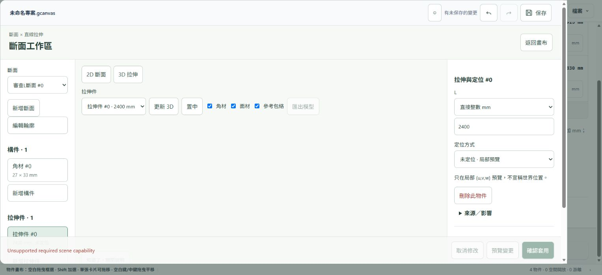
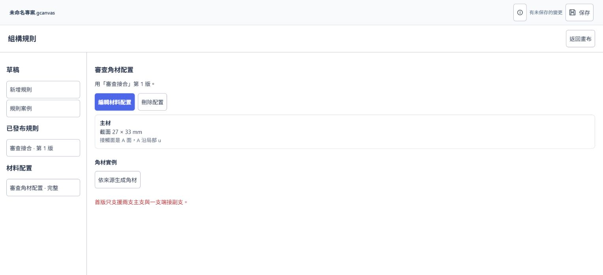
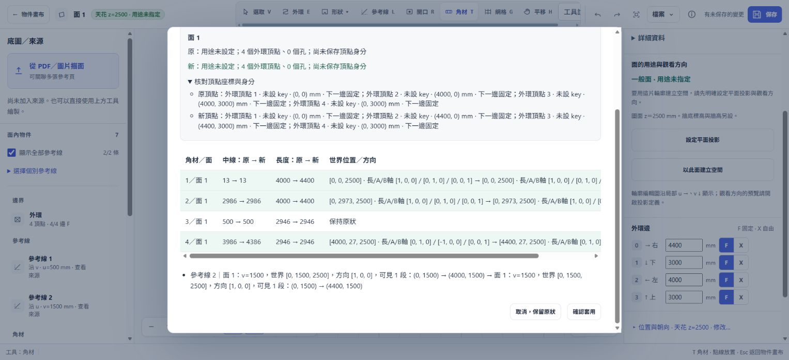

# 構形 Canvas 操作流程與 UI 審查

審查日期：2026-10-16。對象：本機 `D:\geometry-axiom` 的目前 main。這是操作與產品審查，不是功能修復或條文變更。

**判定：主要建模流程存在，但目前不能判為「所有使用者目標都可順利完成」。已實際遇到跨功能建模阻斷、完成後動作不明顯、確認資訊過密，以及尚未交付可見操作的功能。** 自動化通過數與人工完整流程是不同證據；下列分開記錄。

最終主回歸完整跑完：**2,207 通過／0 失敗／0 略過群組，84 個段落與 golden 逐段相符**。空間主套件 **242／0**；角材、延遲回應、歷史專項分別 **79／0、12／0、9／0**。另獨立重跑面內格線 **9／0**，這 9 項主回歸也已透過網格套件間接執行，屬重複驗證。斷面完整驗收與另一條保存重開專項仍中斷，詳見 T01／T02。主回歸收據的 1 筆瀏覽器例外是 P38 刻意觸發的 `fb-auto-probe`，已驗證自動回報成功，並非新增非預期錯誤。

## 版本與審查條件

- 已執行 `git fetch --prune origin`；開工時 HEAD、main、origin/main 同為 `1c807511`，左右差異 `0 / 0`，工作區乾淨。沒有需要拉取的提交。
- 正式入口 `geometry-web/start.ps1` 已啟動 8765；`runtime_version.py --probe 8765` 回報 `fresh:true`、正確 repository、版本 `34fa66ba5d3e76efe92622d8c967b40683d36dba65b5ba815425b273ca94c0d3`。
- 審查先讀產品願景、現行公理與 feedback。F-20261015-001 是舊版本 bridge 中斷的自動紀錄；本次未證明其原因消失，沒有擅自結案。
- 人工操作使用獨立測試服務 8798／8803；自動化使用其他獨立 port、測試專用 feedback 目錄與瀏覽器設定檔。8765 未被測試重置。
- 人工以 Edge 桌面及 390×844 視窗檢查；自動化另涵蓋多種桌面／窄視窗尺寸。窄視窗不等於實體手機觸控驗收。
- IAB／Edge 的原生確認與下載事件控制曾受工具限制；這些限制不直接當作應用故障。`.scene` 的實際下載另從下載檔案讀回，與當下 dump **逐字一致**。
- 未修改公理、閱讀器、產品程式或既有測試。新增內容均為本目錄的審查報告、重現腳本與證據；沒有 commit／push。
- 收尾再次抓取遠端後仍為 `0 / 0`，正式服務也再次通過版本探測。見 [版本收據](version-check.json) 與 [保留開啟的應用](29-app-kept-open.png)。

## 使用者目標與可達性

「人工完成」表示本次從可見入口操作並看到結果；「回歸覆蓋」表示既有測試中有對應檢查，應以旁邊測試收據的實際完成狀態為準。「有限」表示功能有界限，不能推廣到任意情境。

| 使用者想做什麼 | 目前路徑 | 本次判定與證據 |
|---|---|---|
| 開啟最新版應用 | start.ps1 → runtime probe → 實際頁面 | 完成；正確 repo、fresh:true，開啟頁面可見 |
| 找物件、移動／框選／縮放／復原 | 物件畫布工具、物件庫、快捷鍵 | 回歸覆蓋；初始教學會蓋住卡片，見 U06 |
| 建矩形／多邊形、重畫外環 | 建立物件／邊界 → 面內外環與形狀工具 | 回歸覆蓋建面、閉合、交叉拒絕、凹口、伸展與開口；本次另人工進入既有面 |
| 改外框尺寸並看連動 | 面內屬性邊長 → 確認連動變更 | 人工完成 4000→4400；邊界與引用角材更新，確認資訊難讀，見 U04 |
| 建立可引用的參考線 | 面內「參考線」→ 外輪廓來源／比例 → 建立 | 人工完成邊 2 的一半位置 v=1500 |
| 放角材、編輯與多選 | 面內「角材」→ 定位來源、方向、截面、角色 → 放置 | 人工完成第 4 支；回歸涵蓋選取、吸附、法線、角色、跨距與刪除／復原 |
| 從同一份參數帶動幾何 | 建立參數卡 → 欄位與型別 → 來源選單引用 | 人工建立寬 915／長 1830，網格與材料來源選單能看見；公式與相依更新另由回歸覆蓋 |
| 建無限網格，鋪在指定邊界 | 網格來源 → 邊界頂點對齊配置 → 明選承載面套用 | 原生環境人工完成 600×400 網格；步驟多，見 U05。8798 曾中斷，列 O01，不宣稱必現 |
| 編來源子規則、選格線放材 | 來源子規則 → 套用後面內線條／精確 cell 定位 | P88 的桌面／390px 保存重開與來源引用已通過；獨立面內格線專項 9/0。另一保存專項在找特定子線時中斷，見 T02 |
| 設工程材料、做法、面上覆寫 | 檔案 → 工程規格 → 材料／做法／套用至面 | 人工確認入口、表單與核心網格預覽存在；建立／引用／拒絕／匯入由回歸覆蓋 |
| 定義兩構件如何接合 | 建立物件 → 組構規則 → 槽位、構件、局部接合 → 發布 | 人工完成兩構件端抵側規則；發布後下一步藏在重新選取後，見 U02 |
| 給規則指定材料尺寸 | 已發布規則 → 建立材料配置 → A/B／接觸面／擺向 | 人工建立 27×33 完整配置；「完整」只指配置完整，不能保證可生成，見 U03 |
| 依規則生成任意組合件 | 材料配置 → 依來源生成角材 | **有限**：D34 首版只收兩 primary＋一 secondary；符合範圍的生成與保存重開已由 P77 通過。本次人工兩構件規則正確被拒絕，但限制顯示過晚 |
| 由平面邊界建立空間 | 面 → 確認平面投影用途與觀看方向 → 牆底／牆高 → 預覽 → 核對面 → 建立 | 人工完成審查房間，6 面、39.6 m³、帶入 4 支角材；242 項空間回歸通過 |
| 編輯空間高度、來源更新、投影 | 模型庫／空間工作區 → 修改模型／來源影響 | 專項回歸涵蓋高度、來源與投影生命週期、更新、歷史及延遲回應 |
| 建柱／樑／六面盒並看三視圖 | 建立物件與三視圖 | 回歸涵蓋；不能以此推論任意曲面、非正交或施工結構都支援 |
| 建斷面、放構件、拉伸 | 建立物件 → 斷面 → 構件 → 拉伸件 | 人工完成 L 輪廓、27×33 角材與 L=2400 拉伸件 |
| 同一專案有組構規則，再生成斷面 3D | 斷面工作區 → 3D 拉伸 → 更新 3D | **阻斷**：能力檢查拒絕整份場景，見 B01；不是幾何輸入錯誤 |
| 斷面定位、復原／重做後更新3D | 拉伸件 → 進階／宿主 → 轉換 → 歷史 → 更新 | 原生幾何與轉換檢查通過；完整 browser acceptance 在歷史後更新3D中斷，見 T01 |
| 把已定位拉伸件合進空間模型 | 規格 D63 已採納；目前模型庫可以開拉伸件 | **尚未形成完整合併流程**；BACKLOG GEO-256 明列 Q38j-a/b/c 待實作，模型庫並列不等於合併 |
| 在完成面鋪板、檢查縫下承接、建議角材 | PF 原生 API／後續切片 | **無一般使用者可見完整流程**；GEO-255 明記 PF-2 native、complete:false、UI 尚未交付 |
| 從 PDF／圖片描圖並保存來源 | 匯入參考資料／面內從 PDF／圖片描面 | 回歸涵蓋 PDF 頁、描面、來源與完整專案；本次未拿使用者私人文件做測試 |
| 保存完整專案、重開、匯出 | 頂列保存／檔案開啟 .gcanvas／匯出 .scene | 人工 .scene 下載讀回一致；P87／P88 實際 .gcanvas 保存重開通過，包括草稿與原生來源引用。斷面與另一子線保存路徑仍受 T01／T02 阻擋，不能推論所有專案組合 |
| 看角材料單、CSV、定位來源 | 面內構件／模型快照料單與來源動作 | 回歸覆蓋；即時原生角材與保存模型快照須分清楚，不能當成採購／施工排程 |
| 回報目前問題 | F8／回報／Shift+F8 | 回歸覆蓋送出與自動擷取，資料寫入專用測試 feedback 目錄 |
| 任意物件嵌套、施工順序、向量變數、反向尋優 | 願景探索 | 尚無已交付完整流程，不列為「實作違規」，也不能宣稱已完成 |

## 優先處理的實際問題

人工走查的順序與畫面收據如下。這張表記錄每一步的健康度；中間輸入畫面只作過程證據，不冒充提交成功。

| 步驟 | 操作與畫面 | 健康度 |
|---|---|---|
| 1 | [開啟畫布](01-start.png)、[建立物件選單](02-create-menu.png) | 可達；教學遮擋部分物件 |
| 2 | [進入面](03-face.png)、[邊長輸入](04-dimension-after-enter.png) | 可達；輸入尚未提交，不能以此判斷尺寸更新 |
| 3 | [建立參考線](05-guide-form.png) | 完成外輪廓邊中點引用 |
| 4 | [角材表單](06-timber-form.png)、[放置結果](07-timber-result.png) | 完成；表單需捲動 |
| 5 | [鍵盤修改邊長](08-dimension-keyboard.png)、[連動確認](09-impact-confirmation.png) | 完成；確認資訊過密 |
| 6 | [空間設定](10-space-setup.png)、[預覽](11-space-preview.png)、[建立成功](12-space-created.png)、[模型庫](13-model-library.png) | 完成；多階段確認有保護作用，但動作較分散 |
| 7 | [網格來源](14-grid-source.png)、[確認](15-grid-impact.png)、[配置](16-grid-binding.png)、[套用中斷](18-grid-apply-error.png) | 首次中斷；原因未證實，後續原生環境成功 |
| 8 | [參數卡](19-parameter-created.png) | 完成；教學圖解佔據大片工作區 |
| 9 | [組構規則](20-assembly-rule.png)、[材料配置](21-assembly-binding.png)、[生成限制](22-assembly-generation-limit.png) | 發布完成；本例不符合 D34 生成範圍，提示出現較晚 |
| 10 | [斷面 3D](23-section-extrusion.png)、[窄視窗](24-section-mobile.png) | 阻斷；混合專案不被建模能力集合接受 |
| 11 | [原生網格套用確認](25-native-grid-apply.png)、[成功](26-native-grid-applied.png) | 完成；同時觀察到專案資訊按鈕持續停用 |
| 12 | [匯出後畫布](27-export-complete-info-disabled.png)、[工程規格入口](28-engineering-setup.png) | .scene 下載讀回一致；工程規格本次人工只確認入口與現有預覽 |

### B01 · 高優先：合法組構資料會阻斷同專案的斷面 3D

1. 建立參數卡，發布組構規則，再建立完整材料配置。
2. 建 L 形斷面，加入 27×33 角材，建立未定位 L=2400 拉伸件。
3. 按「3D 拉伸 → 更新 3D」。
4. 畫面保持空白，顯示 `Unsupported required scene capability`；匯出模型停用。

**已確認原因**：`section-profile-workspace.js` 的建模請求送入整份 dump；`modeling/base.py:105` 的能力集合只接受 engineering、parameters、section-profile，不接受場景中的 `assembly-rule-authoring/1`。本次純診斷副本移除組構段落後，同一拉伸件可產生 `geometry-model-package/1` 與 2 個物件（材料＋參考包絡）。沒有改動原場景。

這不是建議繞過能力檢查。I32 的拒絕本身是保護；產品問題是已支援的編輯功能無法在同一專案完成建模，介面又未說明是哪個來源造成限制。應補跨能力相容或明確的、保持依賴完整的建模路徑，再加「組構＋斷面」混合專案驗收。

證據：[原請求回應](original-mixed-project.json)、[診斷副本回應](diagnostic-copy-without-assembly.json)、[只讀重現程式](reproduce_model_capability.py)。

重現程式讀取本目錄保存的場景，須以 `--url` 指定另行啟動的測試服務；它只呼叫建模請求，不載入或修改服務中的世界。新回應預設寫入獨立 TEMP 目錄，避免覆蓋本次證據。

### U01 · 中優先：網格發布後「專案資訊」持續停用

原生人工操作建立來源、配置並套用承載面後，返回畫布、進工程規格、再進面內，`#projectInfoButton` 仍為 disabled。當時保存可用、網格可操作，沒有待確認交易。這會阻擋使用者查看專案資訊，且沒有可見理由。

源碼線索：`grid-system-workspace.js:1045` 先停用共享控制項，完成後只有 `current(s)` 成立才復原；成功發布會重開工作區、換掉 state。這是可能的狀態遺留路徑，**尚未以單獨最小測試確認根因**。應在工作區轉移時仍釋放原本持有的共用控制項，並驗證成功、取消、失敗、換工作區四條路徑。

證據：[完成套用後畫布](27-export-complete-info-disabled.png)，人工 DOM 讀回 `isEnabled() === false`。

### U02 · 中優先：組構規則／配置發布後，成功頁沒有接續動作

規則發布後，中央回到「建立自己的接合關係」，僅狀態列說已套用。必須重新點左邊規則，才出現「建立材料配置」；配置發布後又要再點左邊配置，才能找到「依來源生成角材」。

建議保留剛發布的選取與詳細頁，讓既有下一步按鈕直接可見。用成功狀態取代空白起始標題，不需要增加新入口。

證據：[規則編輯](20-assembly-rule.png)、[選回配置後才看到生成入口](21-assembly-binding.png)。

### U03 · 中優先：生成能力的限制，在投入完整編輯後才告知

兩構件端抵側規則與 27×33 配置都能發布，卡片標「完整配置」，點生成才告知「首版只支援兩支主支與一支端接副支」。依 D34，拒絕超出能力的 authoring 規則是正確行為；問題是使用者容易把「完整」理解成可以生成。

建議在既有配置摘要分清「材料配置完整」與「符合目前生成條件」，以同一位置顯示缺少的結構條件，替換含糊成功標示。不要放寬 D34，也不要暗改使用者的規則。

### U04 · 中優先：確認視窗讓人閱讀內部資料，難以判斷真正影響

把邊長 4000 改成 4400 時，視窗展開每個頂點、key、世界座標與軸向陣列，表格需要橫捲。建立一個獨立網格也列出所有「保持原狀」角材。數據完整，但使用者難以快速回答「哪幾支變長、哪一支移動、有沒有非法結果」。

建議首層改成少量變更摘要與可核對的幾何差異：例如「2 支加長 400 mm、1 支平移 400 mm、1 支不變」。完整座標、指令、未變項移入既有詳細區；保持原本預覽／確認原子性。合併現有內容，不另疊一層說明。

### U05 · 中優先：把網格放到面上，需理解三層物件並三次確認

本次最短正常路徑仍是：來源預覽確認 → 選邊界、實際頂點、cell 與格內位置 → 配置預覽確認 → 再選同一邊界的承載面 → 套用預覽確認。來源、配置、承載面的分離有模型意義，但一般目標「把這個排法放在這面」沒有被流程組織成清楚的連續工作。

建議沿用同一工作區與既有交易，在使用者從面出發時預先帶入明確目標，保存後保留操作上下文，清楚顯示「排法／對齊／面上結果」進度。保留獨立建立來源與未放置邊界的能力，避免為求少點擊而偷偷套用。

證據：[頂點與 cell 配置](16-grid-binding.png)、[套用確認資訊](25-native-grid-apply.png)、[實際完成](26-native-grid-applied.png)。

### U06 · 中優先：教學遮住工作物件，示例數值又像目前資料

初始畫布教學浮在卡片上方；參數圖解佔據畫布大片區域，輪播顯示 915／1830／1220，而正在編輯的網格是 600／400。圖解有用，但視覺上不容易一眼分辨「範例」與「目前值」。

建議保留可關閉且記憶已讀的教學，把圖解定位在不遮住當前選取的位置，明顯標示示例，或由目前欄位生成對照；減少重複教學段落。這裡沒有將可關閉教學誤算成 GEO-219 的常駐說明。

證據：[初始畫面](01-start.png)、[參數建立後圖解仍覆蓋卡片](19-parameter-created.png)、[網格來源圖解](14-grid-source.png)。

### U07 · 中優先：斷面物件的找回方式不一致

本次建立斷面與未定位拉伸件後，主畫布仍只列參數、組構、網格與面；3D 模型數字為 0。未定位拉伸件不出現在世界模型符合 D39，但使用者仍需要知道它保存在哪裡。目前須再從「建立物件 → 斷面」進工作區，才找得到既有斷面。

建議把現有斷面入口命名成可同時理解建立與管理的入口，並在既有物件搜尋／分類呈現合法的未定位物件。不要把它偽裝成已定位模型；新增可見項前仍須依 GEO-219 明列合併減項。

### U08 · 低至中優先：桌面與窄螢幕都能容納控制項，但閱讀成本仍高

面內工具列需要橫捲；角材表單與右側屬性需長距離垂直捲動。390px 空間表單有固定底部動作，基本可達性較好，但「確認用途」「預覽」「核對各面」「建立」分散在多個捲動位置。斷面手機版也要經過來源列表才到模型與編輯區。

建議按當前任務展開需要的欄位，把成功狀態、待完成欄位與主動作靠近；替換重複說明，保留必要的數值及方向確認。不能只用「無橫向溢出」或 44px 按鈕宣稱手機容易操作。

證據：[角材表單](06-timber-form.png)、[窄螢幕空間表單](space/after-own-plan-390x844.png)、[窄螢幕斷面](24-section-mobile.png)。

## 尚未證實根因的觀察與測試中斷

### O01 · 單次網格來源已更新訊息

8798 的人工流程在剛建立配置後，選承載面再按「預覽套用」顯示「來源已更新。請返回畫布，再重新開啟工作區。」沒有刻意插入來源修改。8803 使用相同步驟與新編原生 bridge 可成功完成，因此不把它列為必現阻斷。保留 [當下畫面](18-grid-apply-error.png) 供後續查來源快照與工作區重開時序。

### T01 · 斷面完整 browser acceptance 未完成

`tests/test_section_profile_browser.js` 在 1440px 的定位互轉、Undo／Redo 與工作區保持檢查後，等待「更新 3D」使匯出按鈕可用時逾時；原樣重跑及只增加失敗擷取的診斷重跑，共三次都於相同位置中斷。擷取畫面為空白模型，狀態仍寫「已重做」，沒有模型錯誤。相同 native dump 直接請求模型可以成功，所以不能把這次失敗說成原生幾何不合法，也不能宣稱完整斷面／保存／重開驗收通過。

測試包含歷史操作後立即接續更新 3D；可能是歷史的後續讀取或 render 清掉新模型請求。應核對歷史完成邊界與模型請求所有權，在尚未可操作時禁用或等待，避免使用者點了可用的按鈕卻無結果。根因尚未透過專門事件追蹤確定。診斷附檔僅增加失敗擷取，不修改產品或原測試。

收據：[section.log](section.log)、[section-retry.log](section-retry.log)、[診斷畫面](section-diagnostic/failure.png)、[失敗時 native dump](section-failed-dump.json)、[同 dump 直接建模結果](section-failed-model.json)。

### T02 · 保存重開專項在保存前的子線選取階段中斷

`GEOMETRY_SAVE_REOPEN_ONLY=1` 在 WSL bridge 與原生 bridge 都於 `Rule anchor undefined` 中斷：已建立系統、all-cells 2×2 規則、邊界與套用，但測試從當前抽樣線條中尋找 cell (0,0) 的 v 子線未取得。畫面能看到其他子線，也有抽樣未完整提示。這可能是測試把抽樣當完整資料，仍須專門確認；**目前只能說驗收未完成，不能稱保存後資料遺失**。

另外對當下原生場景做只讀精確查詢，`grid-rule-query grid 1 rule 1 cell 0 0` 確實回傳 u=100 與 v=50 的子線，以及完整穩定引用；因此不是該格子線在核心不存在。應先用明確 cell 定位驗證來源與引用，再驗真正下載／重開／逐字 dump；不應改低通過門檻。收據：[精確 cell 回應](save-test-exact-cell.json)、[原生結果](space-save-native/result.json)、[原生失敗畫面](space-save-native/final-state.png)、[WSL 結果](space-save/result.json)。

另一路徑的 P88 桌面及 390px 測試已成功執行真正保存、切換空白新專案、重開，並逐字核對原生場景、來源 key 與 signed binding。保留一份通過重開驗證的 [來源子線專案](source-lines-reopened.gcanvas)。它證明的是該組測試場景，不能取代本節尚未完成的路徑。

## 保留做得好的部分

- 空間流程先確認面用途與觀看方向，牆底與圖面 z 分開，減少默默猜測幾何語意。
- 有草稿／已套用／未保存的狀態區分，重要改動有原子預覽與取消。
- 參數、網格、組構與材料保留來源身分，可用於後續引用；不能為簡化畫面而把來源轉成不透明數值。
- 模型明示角材數、材料體積與參考包絡的差別；未定位拉伸件保留局部語意。
- `.scene` 匯出入口清楚寫出不含底圖、草稿與空間模型，沒有冒充完整專案。

## 建議處理順序與驗收方式

1. 先處理 B01 跨功能建模、U01 共用控制項鎖定，以及 T01／T02 的失敗原因；驗收採同一專案串接多種物件，不能只跑各功能的乾淨場景。
2. 再處理 U02／U03：發布後保留上下文，提前區分規則合法性、材料完整性與生成能力。
3. 精簡 U04／U05：保留 SSOT 與交易語意，讓主畫面首先回答使用者的修改意圖及結果。
4. 收斂 U06／U08：減少遮擋、重複文字與不必要捲動，再做實體觸控與鍵盤全流程驗證。
5. PF 可見操作、斷面併入空間與探索願景各自列交付里程碑；不要把 native-only、條文採納或模型庫並列寫成完整產品流程。

完整測試結果、各 section／group 通過與失敗數及原始 log 見 [TEST-RESULTS.md](TEST-RESULTS.md)。本審查沒有以測試斷言數代表使用者流程數，也沒有聲稱所有輸入組合、實體手機與作業系統原生檔案視窗都已驗證。
