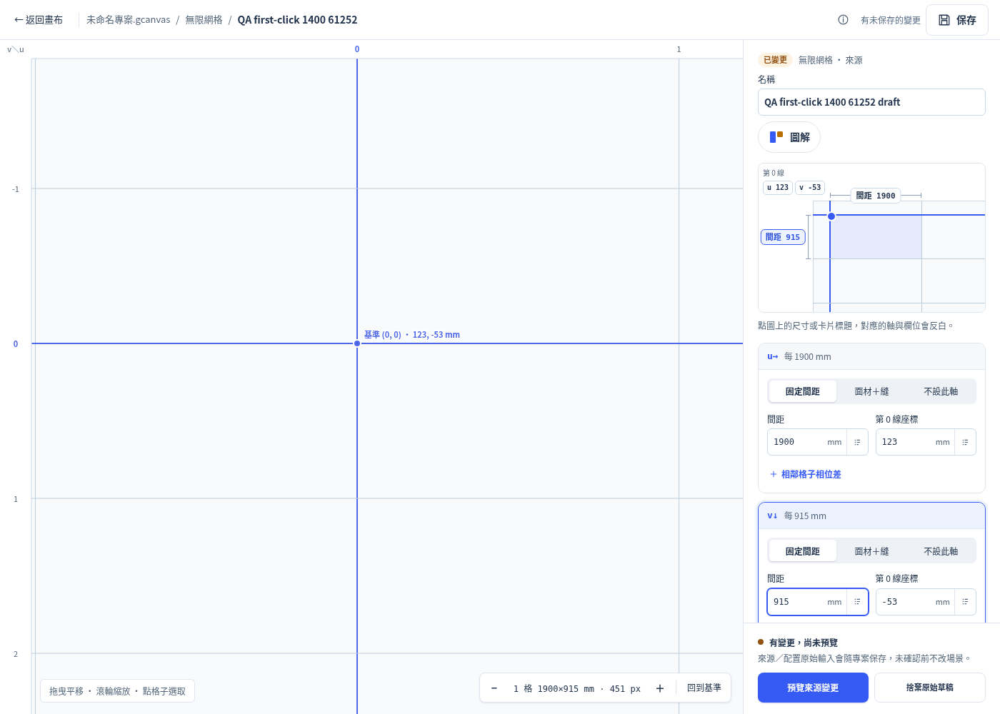
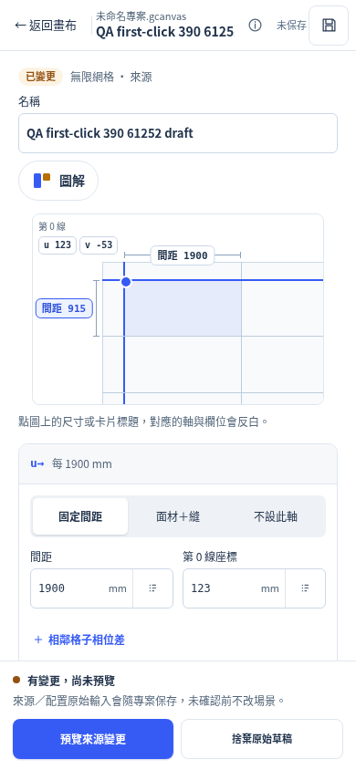
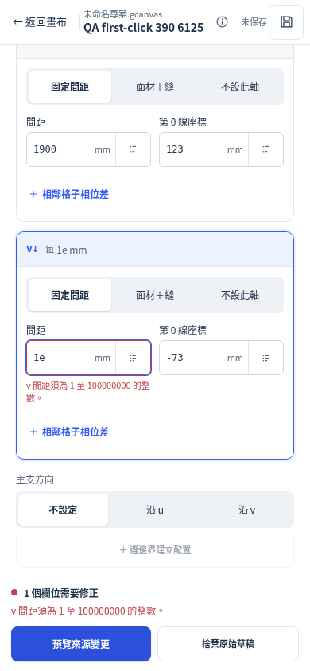
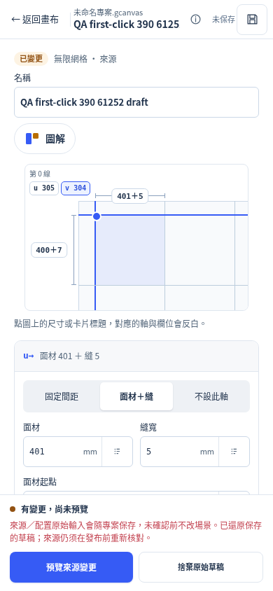

# Definition controls: first-click ownership repair

The authorized JavaScript repair is **`ec4834eca6018b2506e2e822b53d82b02dc605fe`**, following CSS/evidence head `07b844d3af8464a04d0d522c55e5d46382c320ae`. Runtime is **`af56c70a18b10975474542e5bbdc9f4d0b2de1a7301d4b1d539ef860f0573c3c`**, `fresh:true`. This is a new JS-head acceptance, not reuse of the earlier `0b2cbe3` full receipt.

## Root cause and bounded change

The common `drawDefinition` renderer replaced every stage child on input, change and focus updates. The input event had already rendered the new value; a subsequent native change event during pointer activation rebuilt the same diagram and detached the original pressed button before its click could be delivered. Focus updates also unnecessarily replaced keyboard-focusable controls.

The product diff is 15 added lines in `grid-system-workspace.js`. The stage owns a key of its complete live `readAxes` data. If that data has not changed, the renderer retains its current buttons and updates focus, `aria-pressed` and live bound-source styling in place. Changed definition data still redraws immediately during input. A newly created stage always draws afresh, even if values happen to match a previous editor.

Input capture, change handling, validation, source refs, native preview/confirmation, raw schemas, project dirty/history and saving were retained. There is no pointer special case, pointer suppression, timeout, deferred click, second-click requirement or pre-blur workaround. CSS/native/reference/project-store/parameter modules and existing portable/provenance gates remain byte-identical to the pre-JS head; see [identity.json](focus-repair/identity.json).

## Actual first-pointer and keyboard regression

The committed gate is `geometry-web/grid_definition_interaction_browser_test.py`. It uses a clean frozen worktree and explicit isolated native service, and creates only synthetic QA grids via the actual create/preview/confirm controls. Desktop 1400×1000 uses trusted mouse clicks; mobile 390×844 uses `is_mobile=True`, `has_touch=True` and trusted touchscreen taps. Browser plugin was not available; existing Playwright/Chromium was used. Physical phone keyboards/IME and Safari/Firefox are outside scope.

Every pointer case fills the input, scrolls/measures its target without changing focus, explicitly proves the edited input still owns focus, verifies the actual hit target, and sends exactly one trusted pointer action. It checks that the original pressed element survives and itself receives one click. **No pointer case uses Enter, Tab, Escape or blur before that click.** Keyboard tests are separate cases.

| Same frozen browser gate | Pre-JS `07b844d` | Repair `ec4834e` |
|---|---:|---:|
| Assertions | 189 pass / 54 fail | **243 pass / 0 fail** |
| Original pressed control receives first click | 8 / 36 | **36 / 36** |
| Uncaught browser exceptions; warning/error console messages | 0; 0 | 0; 0 |
| Completed both viewports | Yes, exit 1 for regressions | Yes, exit 0 |

The 54 old failures are 26 field-focus failures plus 28 lost first-click failures. Two of the lost clicks already had the requested field highlighted; element-identity checks still detect the loss. Counts are assertions, not scenarios. [Before](focus-repair/before-results.json) and [after](focus-repair/after-results.json) keep the complete checks, actual coordinates, pointer evidence and before/after snapshots.

The 36 pointer cases cover both directions between phase/spacing chips, both zero-line chips, name/spacing changes, card titles, other inputs, normal library reopen after Escape, invalid spacing to the valid other-axis chip, corrected spacing and both panel axes (panel/gap/anchor). Every passing click preserves the edited value verbatim and compares the entire native dump, raw draft, project revision/dirty state, model-operation identity, undo and redo against the snapshot taken after editing and before clicking. Input edits legitimately create raw draft history; the click adds none.

Separate actual-key tests cover Enter in an edited input, Tab leaving it, real Tab navigation to a chip followed by Enter, and Escape from the workspace with raw/history preserved through ordinary library reopen. Invalid `1e` remains inline and focused by an explicit failed preview; that rejected preview changes neither native nor raw/history. A valid panel preview is opened through the real button: recorded API commands are read/preview only, the entire native dump stays unchanged, and Escape cancels with the complete snapshot restored. All mode edits remain draft-only after the initial fixture confirmation.

The first preparation attempt's generic `scroll_into_view_if_needed` left a 390px input under the sticky footer and tapped the preview button. That harness failure remains locally preserved. The corrected gate scrolls the target to the center and proves its real hit target and the still-focused edited input; it does not change the click oracle or pre-complete input editing. The same corrected gate fails on the pre-JS product and passes on the repair.

## New-head integration receipts

| Verification at `ec4834e` | Result |
|---|---|
| Existing independent geometric fixtures | 8 pass / 0 fail |
| Trusted first-pointer/keyboard browser gate | 243 / 0 |
| Affected grid CDP (P70/P71/P78) | 145 / 0 / 0 skip; zero exceptions |
| True portable ZIP/native browser gate | 91 / 0; zero exceptions |
| Raw interpretation/provenance browser gate | 113 / 0; zero exceptions |
| Normal 915/1830 UI workflow, desktop/390px | 63 / 0; zero exceptions |
| Fresh-context File New → chooser reopen of true normal ZIP | Two contexts, four empty/byte-exact restore checks passed |
| Final full CDP, run once after the gates above | 1994 / 0 / 0 skip; 82 sections golden matched |

The new full run reports **one exception event**, its intentionally injected P38 `Error: fb-auto-probe`, logged as `[EXPECTED EXCEPTION]`; there is no unexpected exception and exit is 0. The raw counter was not rewritten as zero. The full run includes composition P72=52 and the restored drag checks. No floor, golden, existing test oracle or source suite was reduced or skipped.

The real normal workflow was also repeated on the new JS head: create `(915,1830)` parameters, bind both grid axes, diagram/card focus, preview/cancel/confirm, modify phase and upstream parameter, remove/reopen stagger without losing saved source, actual Save ZIP, fresh context open and actual undo/redo buttons. [normal-checks.json](focus-repair/normal-checks.json) retains all 63 checks; the known mobile feedback overlay still uses its unobscured lower edge. Ordinary supported ZIPs remain `geometry-canvas/6` and do not claim to preserve undo history. [fresh-zip-results.json](focus-repair/fresh-zip-results.json) independently starts two fresh contexts, uses actual File → New Project to prove the native dump is the empty string, then File → Open Project's actual chooser loads each newly downloaded ZIP. The restored dump equals the archive's `world.scene` byte-for-byte. These are additional normal-flow checks, not a change to the first-click regression's operations.

[gate-receipts.json](gate-receipts.json) indexes the new head, receipts and gzip logs. Short-gate and interaction logs are complete raw outputs. The full terminal fragment preserves the expected-exception line plus the verbatim terminal block beginning at `CDP_SECTIONS`; the complete local full log remains retained, with its byte count and SHA-256 recorded. `gzip -cd focus-repair/<name>.log.gz` restores raw bytes; the manifest hashes both compressed and decoded data.

All displayed cases and submitted evidence are synthetic or repository-authored fixtures. No user Downloads HTML, private case/source files, browser profiles or original project attachments were published. Earlier failures and all original local attempts remain preserved. The remaining base mobile feedback overlay, original CI jobs without runner steps, #61 subrule-editor boundary and separate `space_model_test.js` scope remain as recorded in the initial QA; this repair does not expand those certifications.

## Actual pixel review

Desktop and touch-390 captures were inspected. Chip positions, nested phase layout and line geometry match the preceding one-rule CSS repair; the change affects control ownership and highlight state, without a diagram redesign. The mobile invalid-field capture shows the exact field error and the preserved raw `1e`. Panel phase chips reflect their effective zero coordinates while still targeting the raw anchor fields.

Desktop repeat after real first-click interactions:

390px repeat after real first-click interactions:

390px inline invalid input:

390px panel after real first-click interactions:

