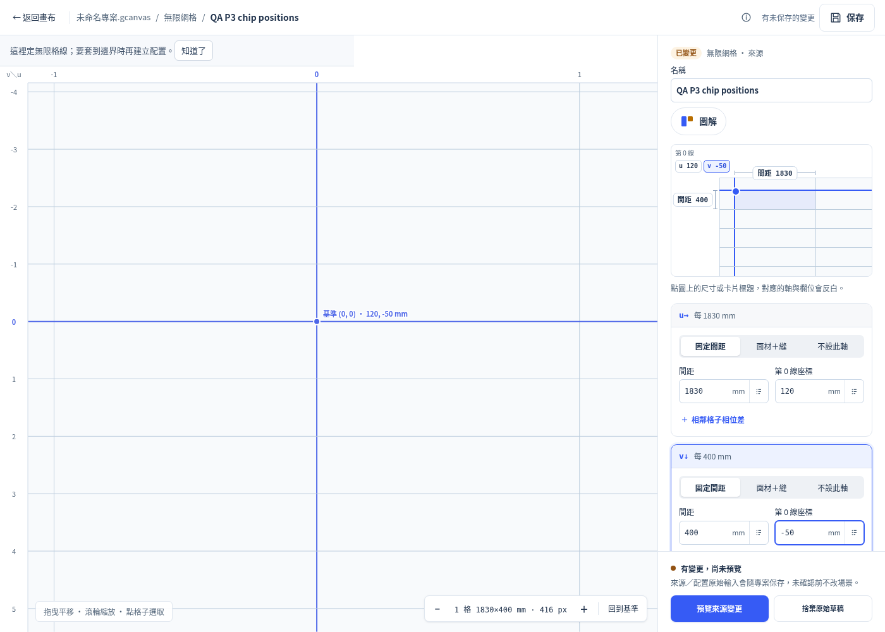
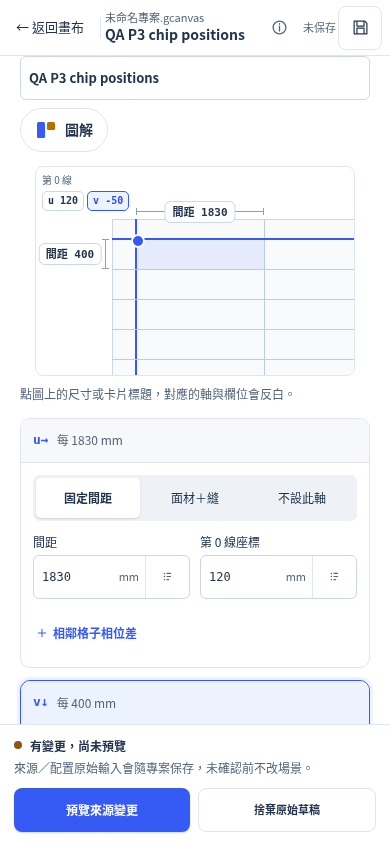
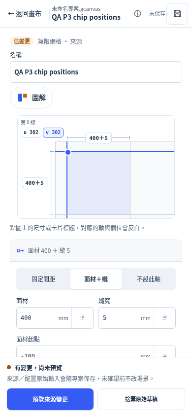
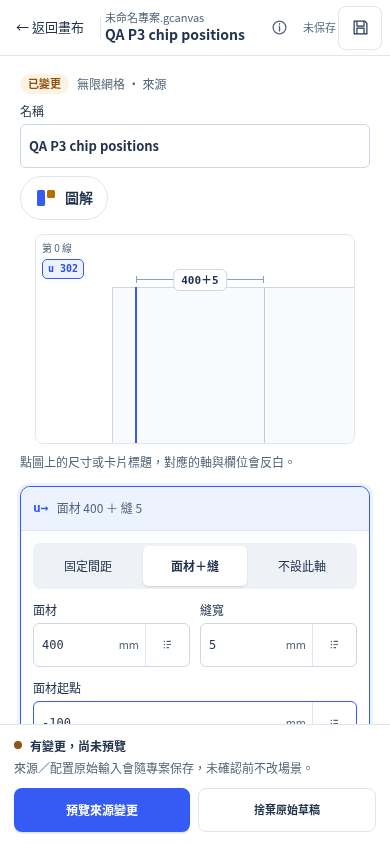
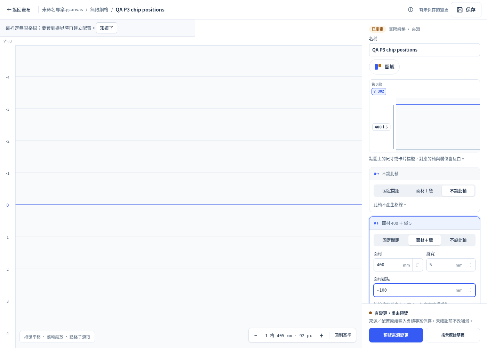

# P3 CSS repair — bounded product acceptance

The authorized one-rule repair is **`b824c0f7985ae5b245b4f06679966cd7737d2e79`**, following evidence commit `fab77152deda0f876eb58b937369833732a045a9`. It adds only `.ig-workspace .ig-def-stage > .ig-chip { position: absolute; }` after the generic chip rule. The dimension chips now use their supplied stage coordinates; nested phase chips remain relative. JavaScript, native sources, raw schemas, references and the earlier eight geometric fixtures are byte-identical to `0b2cbe3`.

## Finding retained: first click after editing an input

An existing interaction defect remains outside this CSS authorization. At both 1400×1000 and touch-enabled 390×844, edit `igVPhase` to `-50` and click the u spacing chip without first finishing input editing. The first click hits the correct chip but does not highlight the u spacing field. A second click works. The entire native dump remains unchanged.

This reproduces on both pre-CSS `fab77152` (runtime `6582cf68…`) and CSS repair `b824c0f` (runtime `e4a3e719…`): four out of four first clicks fail and all four second clicks work. Capture-phase event traces show `pointerdown`/`mousedown` on `u:step`, followed by input `change` and `focusout`; the first attempt has no `click` event. The dialog's existing `onchange` calls `syncDraftState` → `syncDefinition` → `drawDefinition`, which replaces the chip DOM during the pointer interaction. This was not repaired or hidden by a test/oracle change.

Evidence: [before/after event traces](p3-acceptance/first-click-repro.json), [reproducer](p3-acceptance/p3-first-click-repro.py), [first matrix results](p3-acceptance/first-results.json). The first matrix retains **241 pass / 4 fail**. The passing matrix below tests a distinct explicit precondition; it does not supersede those failures.

## CSS checks after completing input editing

The flow under test is: actual Create Object → grid preview/confirm provides a nonempty native baseline → reopen through the object library → switch u/v modes and finish input editing with trusted Tab → click diagram chips → expected field highlight with unchanged saved World.

Environment: Linux Chromium 151 via existing Playwright; Browser plugin not available. UI service `http://127.0.0.1:8806/`, grid-gate service `http://127.0.0.1:8807/`, isolated feedback directories and native bridges. Desktop 1400×1000 uses trusted mouse input; 390×844 uses `is_mobile=True`, `has_touch=True` and trusted touchscreen taps. No force clicks or DOM-hiding styles were used.

| Check | Result at CSS head |
|---|---|
| Page identity, meaningful app, no framework overlay | Pass, both viewports |
| All nine u/v repeat / repeat-panel / none combinations | 18 cases checked across both viewports |
| Dimension chips absolute; nested phase chips relative | Pass for every displayed chip |
| Four chip-to-field focus paths when both axes exist | Pass after trusted Tab completes editing |
| Chip center hit and mobile expanded touch-area hit | Pass for every displayed chip |
| Supplied stage positions applied; no horizontal overflow | Pass in every case |
| Entire saved native World unchanged | 18/18 cases |
| Both axes absent | Explicit “至少設定一軸。”; draft only, not claimed as native-supported |
| Browser errors / warning or error console messages | 0 / 0 |
| Settled-input matrix assertions | **245 pass / 0 fail** |
| Affected grid CDP gate | **145 pass / 0 fail / 0 skip**, zero exceptions |

The grid gate includes P70=113, P71=9 and P78=23, including restored trusted drag checks. Its complete raw log is [p3-grid.log.gz](p3-acceptance/p3-grid.log.gz). This partial mode does not compare the full golden. No golden/floor/oracle or existing product test was changed.

The saved baseline was created with actual preview/confirm. Mode switching and focus clicks in the 18-case matrix remain draft operations; this matrix does not claim an additional native confirmation/save/reopen certification for each combination. The ordinary true ZIP/native/history workflow and full **1994** assertions remain the earlier `0b2cbe3` evidence. As authorized for a one-rule CSS change with unchanged native/JavaScript bytes, full CDP, portable, provenance and native suites were not rerun. Physical device keyboards/IME and Safari/Firefox remain outside scope.

[Settled-input metrics/results](p3-acceptance/settled-results.json), [matrix harness](p3-acceptance/p3-css-acceptance.py) and [exact identity/runtime/binary hashes](p3-acceptance/identity.json) are committed synthetic evidence. Complete matrix, initial failure and reproduction logs use lossless gzip; `gzip -cd p3-acceptance/<name>.log.gz` yields the original bytes. The manifest records compressed and decoded SHA-256 values. All original local attempts and files remain preserved outside the repository.

## Pixel review

Actual desktop/mobile captures were inspected. The v spacing chip now sits in the left dimension gutter instead of covering the origin/grid. The u spacing chip remains above its dimension line; phase-chip positions and layout stay unchanged. Panel mode displays `400+5` and effective zero `302`; single-axis states show only that axis's chips/lines, with no invented cell. Both-none is an explicit draft error. This follows the existing design reference's placement and does not redesign the diagram.

Desktop repeat/repeat:

390px repeat/repeat:

390px panel/panel:

390px panel/none:

Desktop none/panel:

