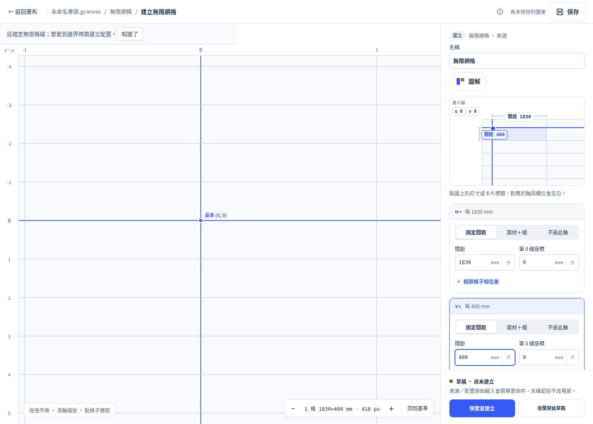
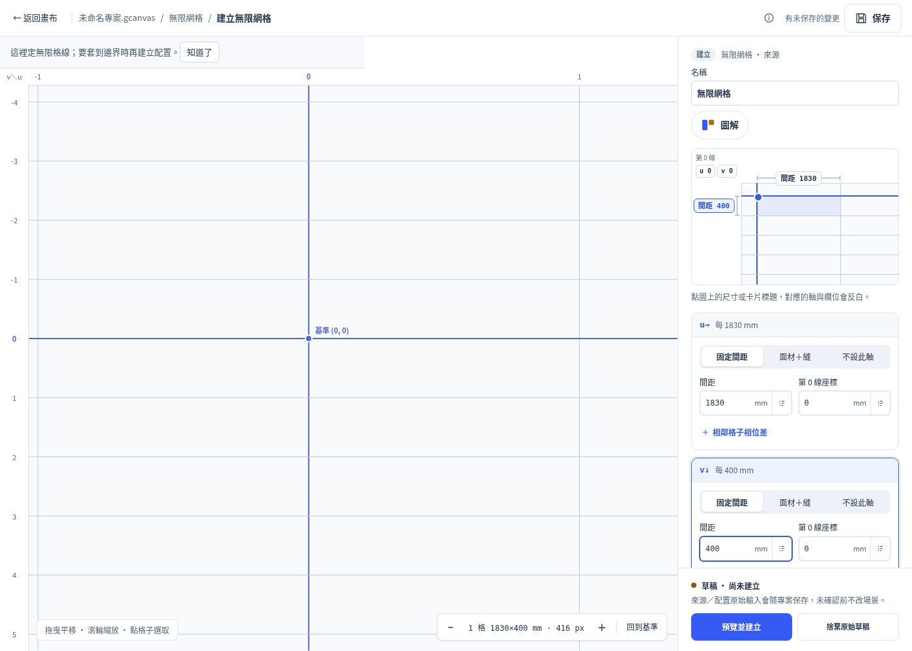
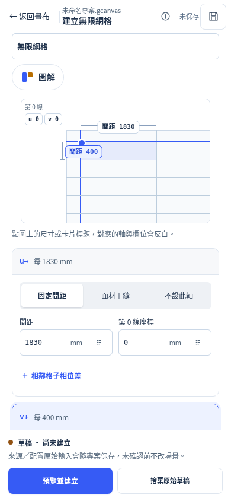
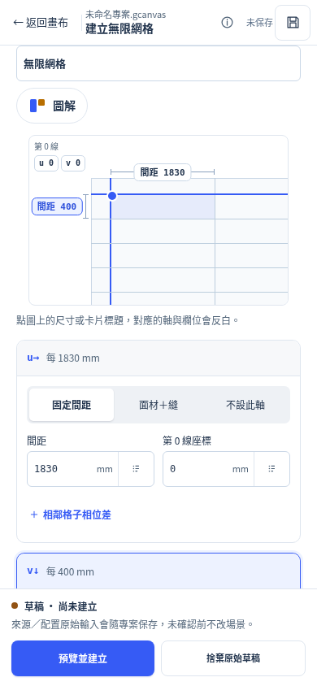

# P3 proposal: restore positioned dimension chips

This is an evaluated proposal, **not a product CSS change**. It addresses the existing CSS responsibility boundary without redesigning the diagram.

The renderer supplies explicit `left`/`top` coordinates for the u/v dimension chips, which are direct children of `.ig-def-stage`. `.ig-def-stage > * { position:absolute }` is overridden by the more specific `.ig-workspace .ig-chip { position:relative }`. Consequently the v chip also inherits the u chip's inline-flow width and moves into the plot.

The minimal proposed product diff is one rule in `geometry-web/grid-system-workspace.css`, immediately after the generic `.ig-chip` rule:

```diff
+ .ig-workspace .ig-def-stage > .ig-chip { position: absolute; }
```

This applies only to the diagram's direct-child u/v dimension chips. The phase chips nested in `.ig-def-zero .ig-def-phases` stay relative and keep their existing flex layout. It changes the chips' layout/hit rectangles, including their existing mobile hit-area pseudo-elements; it does not change text, dimensions, diagram line geometry, field IDs, source references, raw data, native World, transactions or history.

A temporary browser style override was tested against repair `0b2cbe3` at 1400×1000 and 390×844. The product file remained untouched. [p3-prototype-results.json](p3-prototype-results.json) contains before/after metrics and interaction checks:

| Measurement, relative to stage | Before | Prototype |
|---|---:|---:|
| u dimension chip x / y | 129.4375 / 36.5px | 129.4375 / 35px |
| v dimension chip x / y | 74.875 / 78.5px | 3.75 / 77px |
| Phase-chip positions | relative, unchanged | relative, unchanged |

Both viewports return the v chip to the left gutter, preserve all four chip-to-field focus interactions, have no document horizontal overflow, and preserve the entire native dump. The visual direction matches the existing reference PNG. This prototype is not included in the full-1994 product test head, and must not be represented as a committed fix.

If root authorizes the one-rule change, apply it as a separate bounded CSS commit, verify desktop/390px spacing and actual chip hit points (including single-axis/panel cases), and rerun the affected grid gate. No redesign or core changes are needed.

Desktop before:

Desktop browser-only prototype:

390px before:

390px browser-only prototype:

