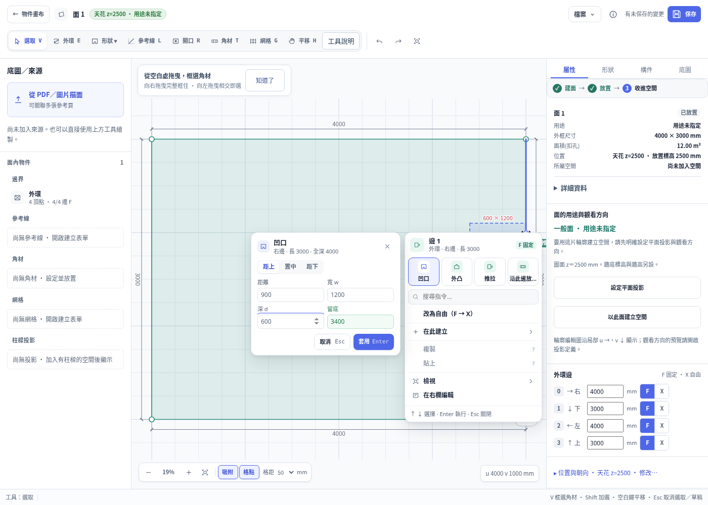
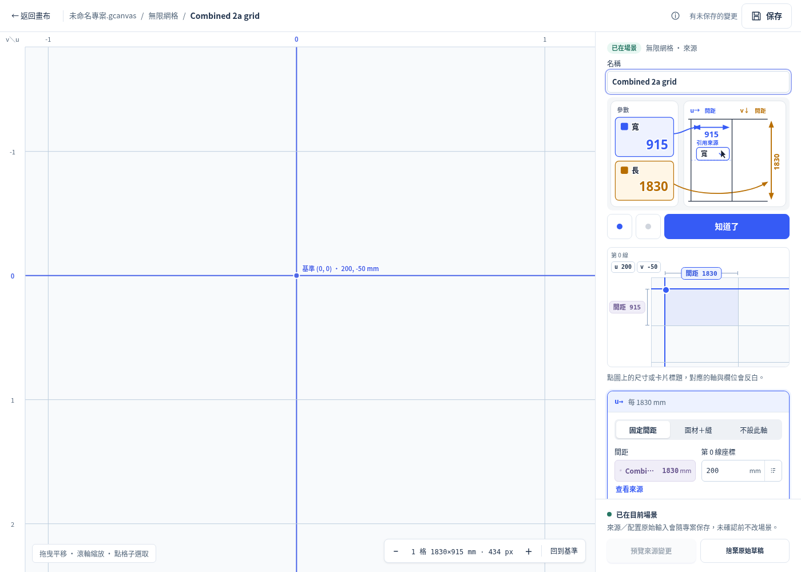
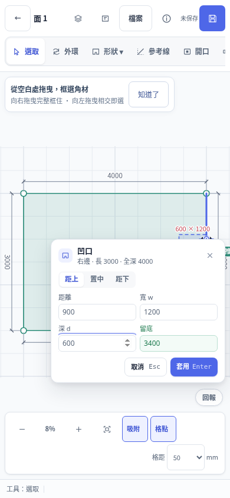
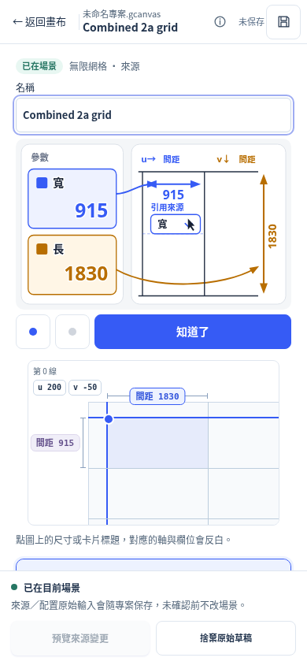

# PR125 + PR130 combined integration acceptance

The tested ordinary merge is **`66d5bbd3b192d31cf4c6a88ba6b70341c5697203`**, tree **`e2543379f69e90a4743846ac204d09c9c46b4b73`**. Its parents are PR130 `b0174da3940f462b80e40b462a4bfd1c08d119d1` and the actual main merge of PR125, `a4caf166675fbdfa4664a55f4d59a5f43c3a50c1` (PR125 source `5a82f4435443872b9cb66ede3da456dad75e4424`). Base before these PRs was `8d134fcb08041708ac174c11185f175cfa369c4a`.

The merge has no conflicts and required no product repair. Only `DOM-CONTRACT.md` was changed by both PRs, in separate sections. All 148 files exclusive to one PR retain their parent's bytes. All 38 native C/header/include files, project-store, reference-workspace, parameters and SSOT retain their prior bytes. The old tested native binaries were reused only after this closure check; their SHA-256 and all preserved-file identities are in [identity.json](identity.json). The combined runtime is **`7b21bdacea0fe96877cfbd0f20b90c55722f9c93f32f468c598f6fb4f546bbe3`**, `fresh:true`, in six separate isolated services under `/workspace/pr130-integration`; no user service was reset.

## Necessary combined scope

PR125 adds the B face menu, cursor, shared app event guards, index assets and viewer rotation fitting. PR130 adds the 2a source renderer, field grouping and fixes. They share runtime, global pointer/Escape handling, workspace transitions and save/history. We therefore ran the affected source/grid/face/cursor/pointer gates plus one project using both workflows. Native/core/store/reference contracts did not change and both independent full regressions were already accepted; unrelated full suites, portable/provenance and SPACE were not repeated. **No new combined full-CDP claim is made.** Prior full receipts remain at their original exact heads, with their original failures and expected P38 exception counters.

| Test on the combined merge | Actual receipt |
|---|---|
| Grid CDP P70/P71/P78 | 145 pass / 0 fail / 0 skip; zero exceptions |
| Separate face signed-lattice P71 probe | 9 / 0 / 0; zero exceptions (also included in grid 145, not nine unique additional cases) |
| Selection/cursor CDP P75 | 37 / 0 / 0; zero exceptions |
| Unmodified B real UI/native acceptance | 87 checks, exit 0, zero app errors; 1440×900 / 390×844 / 720×480 |
| Unmodified first-pointer/keyboard gate | 243 / 0, 36/36 original first clicks delivered once, zero exceptions or warning/error console messages; desktop mouse and touch-enabled 390px |
| Independent diagram fixtures | 8 / 0 / 0 skip |
| Viewer canvas unit contract | exit 0; engine mesh/fit/orbit/pan/zoom assertions; not a browser/GPU certification |
| Same-project B + 2a actual normal/save/history flow | 64 / 0, completed, zero page errors or warning/error console messages; 1400×1000 and 390×844 |

Counts are assertions/checks, not end-to-end scenario counts. Partial CDP receipts do not compare full golden; their original floors and assertions were retained. No test threshold, golden, inherited oracle or production test source was changed. [gate-receipts.json](gate-receipts.json), [gate-exits.json](gate-exits.json) and complete lossless gzip logs preserve the exact commands, timestamps and terminal output.

The Browser plugin was not available. Existing Playwright and Chromium 151 were used. The B test's Chrome-channel launch uses the outside-test [chromium-environment.cjs](chromium-environment.cjs) adapter because this Linux environment has Chromium and no Chrome channel. It changes only executable/launch options, preserving the committed B acceptance assertions and worktree ownership guard. No browser dependency was installed.

## Actual project flow and native evidence

[mixed-flow.py](mixed-flow.py) creates one synthetic native surface as isolated fixture setup. Every subsequent entry, input, preview, confirmation, cancel, save, chooser and history operation uses actual UI/mouse/keyboard controls. API dump/state reads are evidence only. Both widths follow this sequence:

1. Open the face via its real library row, right-click B, enter a 900/1200/600 notch preview, check its independent `[3400,900,4000,2100]` coordinates and zero native writes; cancel and leave via the actual back button. Verify no B menu/operation leaks into 2a.
2. Create the actual `(915,1830)` parameter card, bind both grid axes, edit v phase to `-50` and immediately click the u spacing chip once with the input still active. Highlight succeeds and the entire raw/native/revision/dirty/undo/redo snapshot is unchanged by that click. Preview/cancel/confirm the grid while preserving the existing face and references.
3. Add a parameter-backed phase difference, confirm, close/reopen, remove it as a draft, close/reopen and cancel before explicitly confirming removal. Saved source survives draft removal/cancellation and both spacing references remain explicit.
4. Return through the library to the same face. B preview is native read-only with the grid still present; confirmation yields the independently specified eight notch vertices. One actual B undo restores the complete previous World, including grid/parameters; one redo restores it exactly.
5. Save through the real visible Save button. [1400-combined.gcanvas](1400-combined.gcanvas) and [390-combined.gcanvas](390-combined.gcanvas) are true `geometry-canvas/6` ZIPs containing that face, parameter definitions and grid references together. Their `world.scene` equals the complete pre-save native dump. Only synthetic scene/manifest entries are present; no private attachment is included.
6. Start a fresh browser context, use File → New Project and prove the native dump is exactly the empty string. Use File → Open Project's real chooser to reopen the actual downloaded ZIP. The entire restored native dump equals the archive bytes; bound values and source IDs remain intact.
7. Edit the reopened grid phase to `200`; actual preview/cancel is read-only, confirmation commits it, and actual grid undo/redo restores the entire combined World. Return to B, preview and cancel with two real Escape presses, then reopen 2a. Check unique control IDs and no horizontal document overflow.

[mixed-checks.json](mixed-checks.json) retains all 64 checks, and [mixed-result.json](mixed-result.json) records commands/runtime/console. [postrun-native.json](postrun-native.json) adds a separate HTTP/native read after the run: the current complete World equals the downloaded ZIP scene with exactly the explicitly confirmed u-phase change. It is labelled as a post-run read, not a recreated historical snapshot. Ordinary ZIPs do not claim to preserve undo history; new transactions after reopen were tested.

The initial mixed attempt passed 20 desktop checks through actual ZIP save, then its fresh-project waiting predicate used nonexistent `oc.objects` and threw. It was incomplete, exit 1, not green. [mixed-attempt1-result.json](mixed-attempt1-result.json), its complete gzip output, original script and [historical failure capture](mixed-attempt1-failure.png) are preserved. Only this outside-product predicate was corrected to `Object.keys(oc.bmap).length===0`; the separate empty native dump assertion stayed exact and no timeout/oracle/floor was relaxed. Only the mixed flow was rerun after this harness correction; already-passing gates were not rerun.

## Pixel review, limitations and handoff

The four desktop/390px B-preview and reopened-grid images below were actually inspected. B uses its existing responsive form/menu arrangement; cancellation restores the menu. The 2a diagram/chips, bound source styles, stage placement and sticky footer remain as previously accepted. The initial source/2a screenshots and original exact-head evidence in `cloud-qa` and `issue116` remain untouched. The 390px create-grid feedback-center obstruction remains a base issue; the flow records and uses its unobscured lower edge with a real click, without hiding the button or force-clicking.

This is synthetic Chromium responsive/touch simulation, not physical phone/iOS/IME/OS-picker/Safari/Firefox certification. Advanced trial stays presentation-only; #61 source-subrule authoring is not certified. New combined full CDP/SPACE, physical-device acceptance and Hosted CI remain tracked; the user's explicit authorization accepts current cloud acceptance for this integration decision and does not permit bypassing branch protection. This agent did not mark PR130 ready or merge it, and did not mutate main or PR125. The final evidence commit is documentation only, with identical runtime assets; the parent receives its exact head/tree for expected-head review and merge.

All raw files and incomplete attempts remain under `/tmp/pr130-combined-20261004`. The submitted evidence is synthetic/repository-authored only; no Downloads source HTML, user project, private attachment or browser profile is published. [manifest.json](manifest.json) hashes each submitted file and the decoded bytes of gzip evidence.

