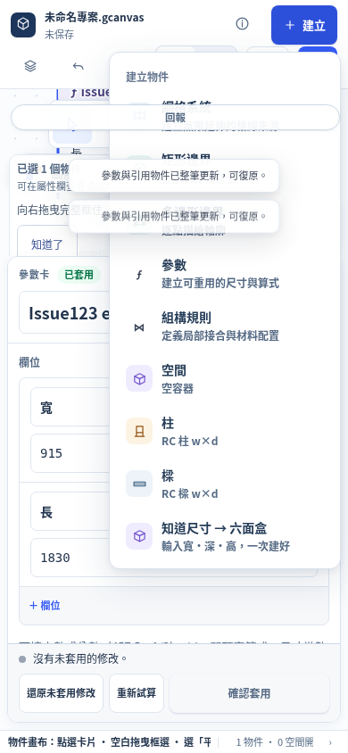
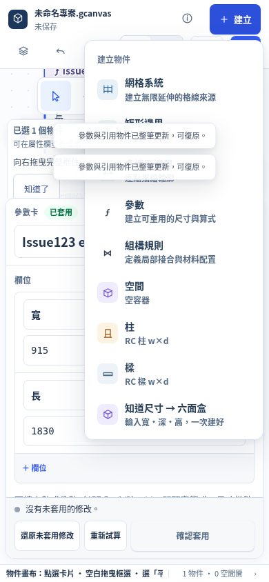
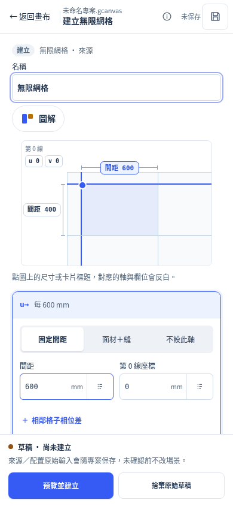

# #123 Create / feedback overlay regression

Narrow repair on main **`ff279f2ab973d29586ada90f69d7fb62a1885973`**. Product/test commit: **`b43b9c791d69f0cfac889a5d68551e874d1cd93e`**, tree **`8b87c252570c0a6de8812d2f4c5f127b0e327d2f`**. GitHub repository metadata and `git ls-remote` confirmed **ZhiQiYang/geometry-axiom**, default branch main, at the requested base. The initial worktree was clean.

This addresses only the existing 390px Create → 網格系統 obstruction within #123. It does not certify all of #123 or redo PR125/130. The #48 shared integration writer was explicitly excluded from these feedback/menu CSS selectors in the delegation. No app.js, index.html, project-store, reference-workspace, feature-attachments, native sources or inherited tests were edited.

## Runtime root cause and repair

After real parameter creation **and editing/confirmation**, mobile `drawer-right-open` supplied `left:12px`; the canvas feedback rule supplied `right:9px` without clearing that left anchor. With width auto, the fixed feedback launcher stretched to **369px**. It also painted at **z-index 90**, above the existing Create menu's **85**, in the same root stacking context. Ancestor styles and the runtime hit stacks confirmed the shared positioning/layer responsibility; this was not a nested stacking-context problem.

The grid item remained at `(131,101.390625)`, size `242×56.890625`; its center `(252,129.8359375)` hit `fbButton`. The first trusted mouse click and touch tap opened feedback and left the grid closed. The original report is also recorded in `../grid-2a-validation/combined-pr125/mixed-checks.json`; its lower-edge continuation was not reused here.

Two CSS changes repair both causes:

- The canvas feedback rule resets `left:auto`, restoring the launcher to **47px** at 390px rather than retaining incompatible left/right anchors. This applies to canvas positioning across breakpoints, without a 390px exception.
- The collapsed launcher uses **84**, immediately below the existing menus (**85**). The open feedback panel retains **95**. Menus own even their actual intersection with the small launcher; F8 still opens feedback and its controls remain accessible. No menu/modal layers were raised.

The existing `btnQuickGrid → btnNewGridSystem` forwarding click remains intact. Evidence distinguishes its untrusted internal click from the exactly one trusted pointerdown/click at the menu center. No forced click, pre-blur, second click or lower-edge target is used for any tested grid-menu entry.

## Acceptance receipts

Browser plugin not available. Existing Playwright and Chromium **151.0.7922.173** were used, without dependency changes, against isolated loopback servers and separate feedback directories under `/tmp`.

| Check | Result / evidence |
| --- | --- |
| Identical regression on untouched base, 390px mouse + touch | **6 pass / 4 expected fail**, exit 1; [before-results.json](before-results.json), [before.log.gz](before.log.gz) |
| Repaired flow, 390×844 / 900×900 / 1400×1000, mouse + touch | **138 / 0**, exit 0; [after-results.json](after-results.json), [after.log.gz](after.log.gz) |
| Unmodified first-pointer / keyboard / inline-error regression | **243 / 0**, 36 original first pointer cases delivered once; [pointer-results.json.gz](pointer-results.json.gz), [pointer.log.gz](pointer.log.gz) |
| Unmodified grid CDP, P70/P71/P78 | **145 / 0 / 0 skipped** |
| Unmodified parameters CDP, P76 | **86 / 0 / 0 skipped**, completed retry |
| Unmodified composition CDP, P72 | **52 / 0 / 0 skipped** |
| Unmodified UIUX CDP, P73 | **65 / 0 / 0 skipped** |

All final runs have zero uncaught browser errors. The independent flow also has zero warning/error console messages, meaningful page identity, no blank shell/framework overlay, and real screenshots. Counts are assertions, not independent end-to-end scenarios. CDP runs are explicitly partial and retain their original floors; **no full golden/full-CDP certification is claimed**. Complete commands, scopes and runtime identities are in [gate-receipts.json](gate-receipts.json); terminal logs are preserved losslessly as gzip.

The first parameters run passed 20 assertions then aborted because its existing screenshot path `/tmp/geometry-tests/parameter-mobile.png` had no parent directory. This environmental failure is preserved in `parameters.log.gz` and the original receipt. Creating that TEMP directory and rerunning only P76 produced 86 passing assertions. No test or threshold was changed to resolve it.

The new independent flow creates and edits an actual parameter card, enters Create with the input still active, measures/clicks the grid center once, switches real left/right/closed drawers, checks every menu-item center and Escape focus restoration, and reopens by the first center click. It opens feedback through the button/F8, writes feedback, checks menu Escape retains that note, and verifies F8/Esc cancellation retains the dirty parameter form. It restores that form through the existing control, edits/returns/reopens an exact raw grid draft across feedback, previews/cancels/confirms the grid, and checks native undo/redo byte equality.

Navigation, feedback, reopen and cancelled preview preserve full native content and existing history entries. **First-ever grid creation intentionally records the existing single local “編輯網格草稿” history entry**; the test explicitly checks its kind/action and unchanged preceding history. Editing a grid draft likewise retains its existing local history semantics. Confirmation adds exactly one core transaction and one grid definition; removing its definition/display-position lines yields the complete pre-confirm native bytes. No unexpected native/history writes are permitted.

## Provenance and limits

[manifest.json](manifest.json) records both runtime fingerprints, identical before/after regression SHA-256, all protected native/shared/test hashes, and evidence hashes. The repaired normal-flow run occurred immediately before the product/test commit, using exactly its committed CSS/test bytes. The original pointer and CDP gates ran at the clean committed head. Adding evidence did not change runtime assets. Before runtime: `7b21bdacea0fe96877cfbd0f20b90c55722f9c93f32f468c598f6fb4f546bbe3`; after: `9dc7182be0a5641f43e82df2708d62e3a8e541b82e79bbf479be2b3f07b0638f`; both were `fresh:true` in their own checkouts.

Synthetic work is limited to resetting isolated fixture worlds and browser touch emulation. All tested inputs, previews, confirmations, cancels and history operations use real UI/native responses. No geometry/transport response is mocked. Saved `*-confirmed.scene` files are test fixtures, not user project backups.

**Physical phone, soft keyboard/IME, OS chooser and other browser engines remain unverified.** This PR is for the parent task's independent review and sequential merge; it must remain draft until that review. No ready/merge/deploy operation was performed.

Reproduce from the checkout root with a fresh isolated native service:

```sh
python3 tests/test_issue123_create_feedback_browser.py --url http://127.0.0.1:<test-port>/ --out /tmp/issue123-feedback
```

Use `--repro` for the identical original 390px mouse/touch oracle on the untouched base. [run-gates.py](run-gates.py) preserves the actual isolated CDP runner; update its checkout path for another environment and create `/tmp/geometry-tests` for the existing P76 screenshot path.

## Real screenshots

Before, 390px (the stretched launcher intercepts the grid center):



After, same menu and grid center:



After the first trusted touch tap at the exact grid center:


