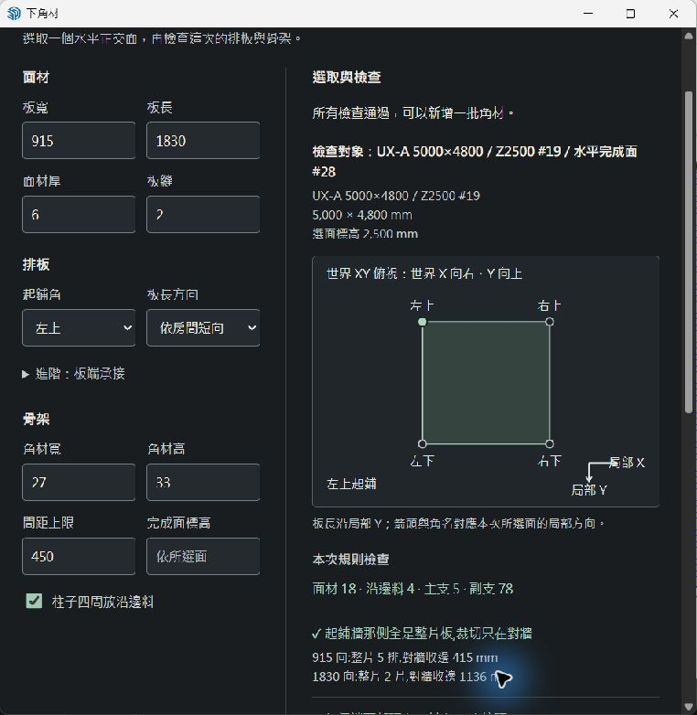
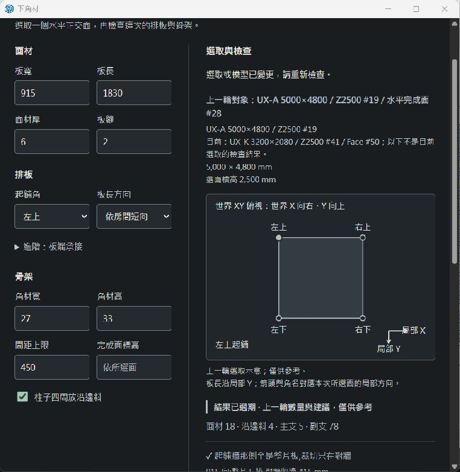
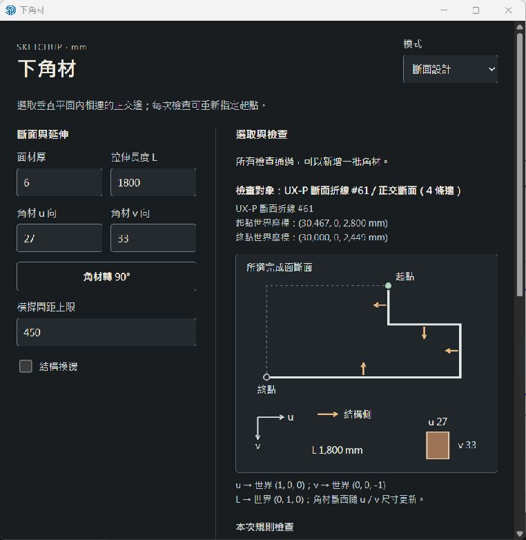
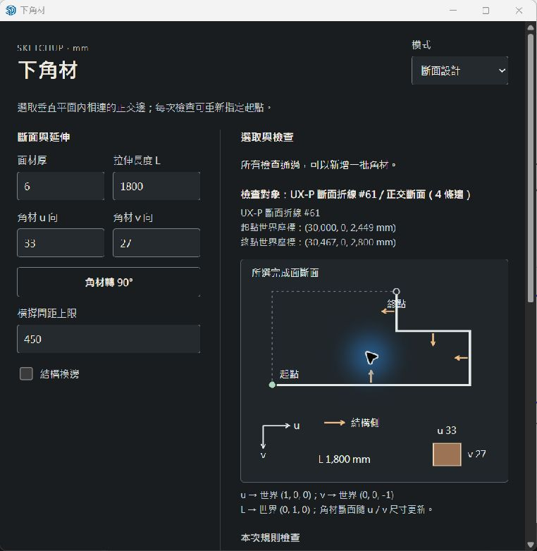

# SketchUp 原生操作回歸：2026-10-13

環境：Windows、SketchUp 26.0.429、內建 Ruby 3.2.2。使用獨立空模型與本目錄的 [夾具](native-ui/fixture.rb)，未修改使用者既有模型。選取切換由 Ruby Console 呼叫夾具的 `select`；檢查、參數修改、生成、起點選擇與一次復原均操作真實 SketchUp／HtmlDialog 介面。這些截圖不是瀏覽器 mock。

## 實際操作及結果

1. **A 檢查後改選 B：通過。** A 為 5000×4800、Z=2500，檢查結果依面材／沿邊／主支／副支為 18／4／5／78。只切換到 B 後，畫面保留 A 的結果但標成過期，同時顯示目前的 B，生成停用；重新檢查 B 才可生成。B 為 3200×2080、Z=2800，世界 X 從 12000 開始，間距上限 450 時數量為 8／4／3／20。[A 的唯讀紀錄](native-ui/a-checked.json)
2. **更改間距並新增第二批：通過。** 將 B 的上限 450 改為 300，上一輪數量留作過期參考，生成停用；重新檢查後副支變成 28。生成成功訊息明示新增批次、既有批次保留，以及下次須重新檢查。兩批 PID 為 94、1096，參數上限分別是 450、300。[兩批紀錄](native-ui/b-two-batches.json)
3. **生成後立即一次原生復原：通過。** 在第二批生成後、沒有儲存或切換編輯路徑之前，從 SketchUp 編輯選單執行一次復原。PID 1096 消失，PID 94 的全部已記錄欄位保持相同；編輯路徑相同。原生復原清空選取，不能宣稱選取也完全保留。此比較包含屬性、角色數量及世界包圍盒，並非逐頂點比對。[復原後紀錄](native-ui/b-after-one-undo.json)
4. **逐項修正仍可參考建議：通過。** 廚房柱孔夾具 K 使用右上起鋪、板長沿 Y 時主支撞柱，畫面提供「左上／板長沿 Y」與「左下／板長沿 Y」兩個可行選擇。改成左上後，這兩個舊建議仍可見並標示結果過期；未重查前生成停用。
5. **同一斷面重選起點：通過。** 在介面切到斷面並選取 P，將拉伸長 L 改成 1800。按「檢查／選起點」明選端 2（世界 30467, 0, 2800），檢查通過。按「角材轉 90°」後示意與欄位由 u=27、v=33 交換成 u=33、v=27，檢查失效。再次檢查明選端 1（世界 30000, 0, 2449）後通過，L=1800 與旋轉後尺寸仍保留。這條手動流程沒有再按生成或取消；生成及反向幾何另由原生腳本驗證。
6. **最後修正的方向圖及連續選取：通過。** 原生操作發現平釘圖標題與角名重疊，以及結果已過期後再次換選取未刷新「目前對象」。修正後重新檢查 A，世界座標與局部 X／Y 清楚分開、標題無重疊。隨後不重新檢查，依序切 B、K，摘要兩次均刷新，仍保留 A 的過期結果並停用生成。[連續切換後唯讀紀錄](native-ui/final-a-to-b-to-k-stale.json)

## 原生截圖

平釘方向與角名（最後版本）：

已過期後再次切換，仍顯示目前 K（最後版本）：

斷面第一次選端 2，L=1800：

交換 u／v 並改選端 1，L=1800 保留：

## 版本與原始證據

操作分成兩階段，不能把全部截圖當作同一個包的截圖：

- 第 1–5 項在當時的 RBZ `9983c2cfd5b3ad85841c4a0ce4a6364e6be0bf8524ede807db8b7ce505cdd345` 對應程式執行。兩張斷面截圖屬此階段。
- 第 6 項載入最終 RBZ 的 `su/dialog.rb` 與 UI；其他已載入 Ruby 來源未變。兩張平釘截圖屬此階段。後續又以最終包的完整程式，在各自空模型重跑兩套原生腳本，並逐檔核對載入來源。
- **最終交付 RBZ SHA-256：`77df4118d775117fc7e7f1d7f10bda24352547b45c7acd40ce521e7eb721d22a`**；41,212 bytes、15 個執行檔案。包內容與 repo 來源逐檔相同，重複打包結果相同，見 [打包紀錄](pack.txt)。
- [完整原生驗收 JSON](native-full-result.json)／[完整 stdout](native-full-stdout.txt)：2874 個斷言，`passed=true`、`semantic_exit_code=0`、`source_unchanged=true`、`first_failure=null`。
- [原生工作流 JSON](native-workflow-result.json)／[完整 stdout](native-workflow-stdout.txt)：73 個斷言，同樣通過。包含檢查不污染 Undo／Redo、一次復原、失敗交易的資源及選取恢復、過期生成閘門與斷面起點重選。此腳本直呼真 SketchUp 後端，不代表 HtmlDialog 點按；上方手動流程補上介面驗證。
- [修正前 Undo 重現](ux-undo-context.txt)及[失敗交易首輪原始失敗](ux-workflow-before-abort-selection.txt)保留；測試驅動器自身的重入問題另記 `ux-native-driver-*`，不混充產品失敗。

本次由 Ruby Console 載入已解壓且逐檔驗過的 RBZ 程式，沒有執行擴充功能管理員的安裝流程，也未做螢幕閱讀器驗收。所有成功宣稱只適用於以上實際執行的流程。
